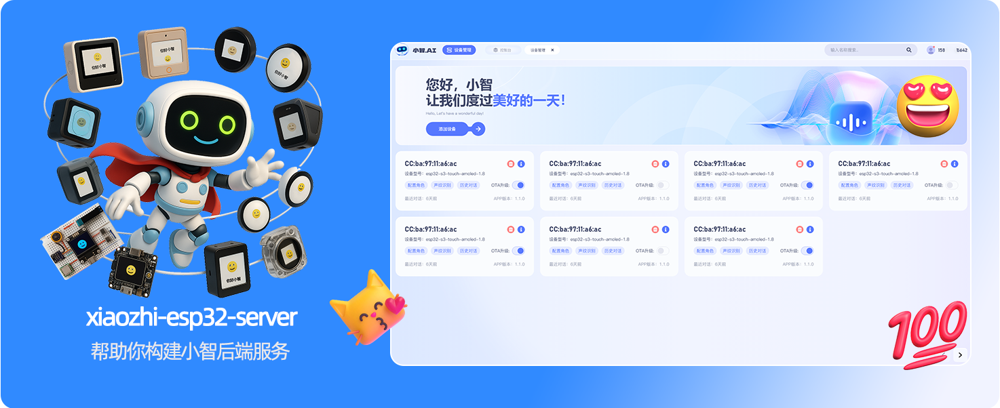
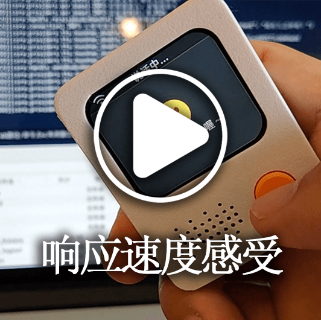
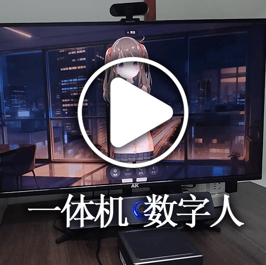
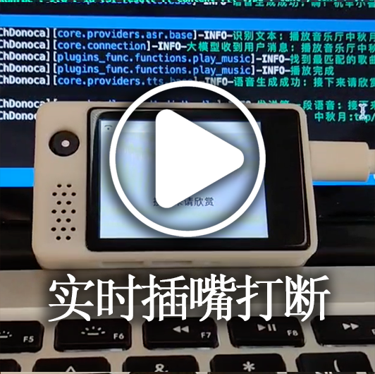
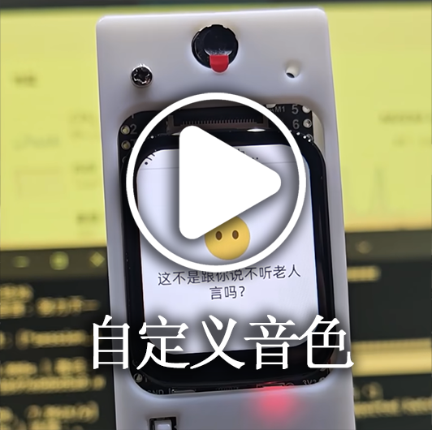
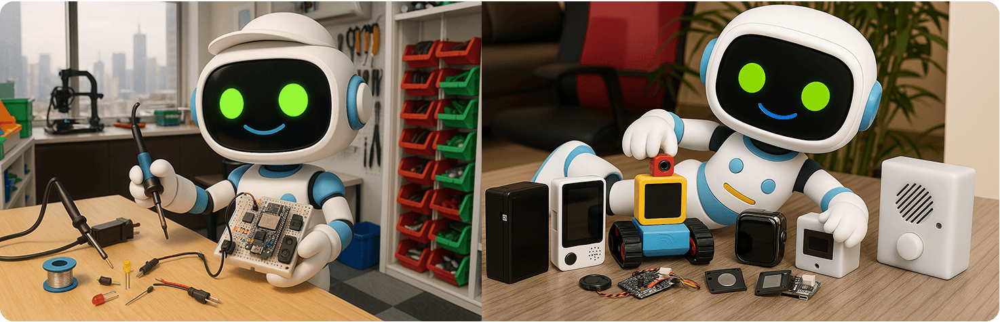
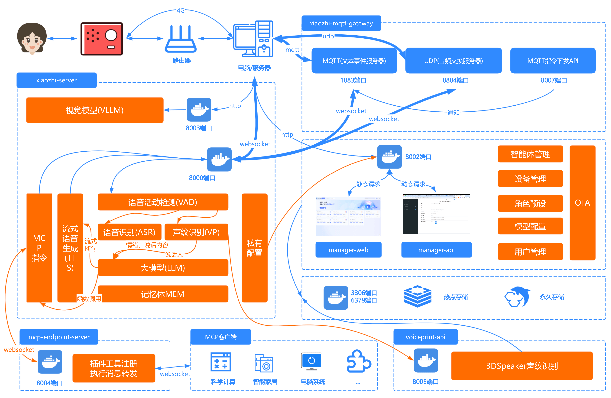

[](https://github.com/xinnan-tech/xiaozhi-esp32-server)

<h1 align="center">Servicio backend Xiaozhi xiaozhi-esp32-server</h1>

<p align="center">
Este proyecto desarrolla sistemas de hardware y software para terminales inteligentes a partir de la teoría y la tecnología de la inteligencia simbiótica humano-máquina<br/>y ofrece el servicio backend del proyecto de hardware inteligente de código abierto
<a href="https://github.com/78/xiaozhi-esp32">xiaozhi-esp32</a><br/>
Implementado en Python, Java y Vue según el <a href="https://ccnphfhqs21z.feishu.cn/wiki/M0XiwldO9iJwHikpXD5cEx71nKh">protocolo de comunicación Xiaozhi</a><br/>
Compatible con el protocolo MQTT+UDP, el protocolo WebSocket, puntos de acceso MCP, reconocimiento de huella de voz y bases de conocimiento
</p>

<p align="center">
<a href="../FAQ.md">Preguntas frecuentes</a>
· <a href="https://github.com/xinnan-tech/xiaozhi-esp32-server/issues">Informar de problemas</a>
· <a href="../../README.md#%E9%83%A8%E7%BD%B2%E6%96%87%E6%A1%A3">Documentación de despliegue</a>
· <a href="https://github.com/xinnan-tech/xiaozhi-esp32-server/releases">Notas de la versión</a>
</p>

<p align="center">
  <a href="../../README.md"></a>
  <a href="./README_en.md"></a>
  <a href="./README_vi.md"></a>
  <a href="./README_de.md"></a>
  <a href="./README_pt_BR.md"></a>
  <a href="./README_es.md"></a>
  <a href="https://github.com/xinnan-tech/xiaozhi-esp32-server/releases">
    
  </a>
  <a href="https://github.com/xinnan-tech/xiaozhi-esp32-server/blob/main/LICENSE">
    
  </a>
  <a href="https://github.com/xinnan-tech/xiaozhi-esp32-server">
    
  </a>
</p>

<p align="center">
Liderado por el equipo del profesor Siyuan Liu (Universidad Tecnológica del Sur de China)
</br>
刘思源教授团队主导研发（华南理工大学）
</br>

</p>

---

## A quién va dirigido 👥

Este proyecto debe usarse junto con hardware ESP32. Si ya ha comprado hardware relacionado con ESP32, se ha conectado con éxito al servicio backend desplegado por Brother Xia (虾哥) y quiere montar por su cuenta su propio servicio backend `xiaozhi-esp32`, este proyecto encaja con lo que busca.

¿Quiere ver cómo se usa? Pulse los vídeos 🎥

<table>
  <tr>
    <td>
      <a href="https://www.bilibili.com/video/BV1FMFyejExX" target="_blank">
        <picture>
          </picture>
      </a>
    </td>
    <td>
      <a href="https://www.bilibili.com/video/BV1vchQzaEse" target="_blank">
        <picture>
          </picture>
      </a>
    </td>
    <td>
      <a href="https://www.bilibili.com/video/BV1WEcxzFEAT" target="_blank">
        <picture>
          </picture>
      </a>
    </td>
    <td>
      <a href="https://www.bilibili.com/video/BV1CKVz6UEuB" target="_blank">
        <picture>
          </picture>
      </a>
    </td>
    <td>
      <a href="https://www.bilibili.com/video/BV1C1tCzUEZh" target="_blank">
        <picture>
          </picture>
      </a>
    </td>
  </tr>
  <tr>
    <td>
      <a href="https://www.bilibili.com/video/BV1VC96Y5EMH" target="_blank">
        <picture>
          </picture>
      </a>
    </td>
    <td>
      <a href="https://www.bilibili.com/video/BV12J7WzBEaH" target="_blank">
        <picture>
          </picture>
      </a>
    </td>
    <td>
      <a href="https://www.bilibili.com/video/BV1Co76z7EvK" target="_blank">
        <picture>
          </picture>
      </a>
    </td>
    <td>
      <a href="https://www.bilibili.com/video/BV1pNXWYGEx1" target="_blank">
        <picture>
          </picture>
      </a>
    </td>
    <td>
      <a href="https://www.bilibili.com/video/BV1TJ7WzzEo6" target="_blank">
        <picture>
          </picture>
      </a>
    </td>
  </tr>
  <tr>
    <td>
      <a href="https://www.bilibili.com/video/BV1ZQKUzYExM" target="_blank">
        <picture>
          </picture>
      </a>
    </td>
    <td>
      <a href="https://www.bilibili.com/video/BV1zUW5zJEkq" target="_blank">
        <picture>
          </picture>
      </a>
    </td>
    <td>
      <a href="https://www.bilibili.com/video/BV1Exu3zqEDe" target="_blank">
        <picture>
          </picture>
      </a>
    </td>
    <td>
      <a href="https://www.bilibili.com/video/BV1CDKWemEU6" target="_blank">
        <picture>
          </picture>
      </a>
    </td>
    <td>
      <a href="https://www.bilibili.com/video/BV12yA2egEaC" target="_blank">
        <picture>
          </picture>
      </a>
    </td>
  </tr>
</table>

---

## Advertencias ⚠️

1. Este proyecto es software de código abierto. Este software no mantiene relación comercial alguna con los proveedores de API de terceros a los que se conecta (incluidos, entre otros, plataformas de reconocimiento de voz, modelos de lenguaje y síntesis de voz), y no ofrece ninguna garantía sobre la calidad del servicio de dichos proveedores ni sobre la seguridad de sus fondos. Se recomienda elegir de forma preferente proveedores que cuenten con las licencias de actividad correspondientes y leer con atención sus condiciones de servicio y su política de privacidad. Este software no custodia ninguna clave de cuenta, no interviene en el movimiento de fondos y no asume el riesgo de pérdida del saldo recargado.

2. Las funciones de este proyecto no están completas y no ha superado una evaluación de seguridad de red. No lo utilice en entornos de producción. Si despliega este proyecto en una red pública con fines de aprendizaje, aplique las protecciones necesarias.

---

## Documentación de despliegue



Este proyecto ofrece dos formas de despliegue. Elija según lo que necesite:

#### 🚀 Elección del método de despliegue
| Método de despliegue | Características | Escenarios | Documentación de despliegue | Requisitos | Tutoriales en vídeo |
|---------|------|---------|---------|---------|---------|
| **Instalación simplificada** | Diálogo inteligente, gestión de un solo agente | Entornos con pocos recursos; los datos se guardan en archivos de configuración y no hace falta base de datos | [①Versión Docker](../Deployment.md#%E6%96%B9%E5%BC%8F%E4%B8%80docker%E5%8F%AA%E8%BF%90%E8%A1%8Cserver) / [②Despliegue desde el código fuente](../Deployment.md#%E6%96%B9%E5%BC%8F%E4%BA%8C%E6%9C%AC%E5%9C%B0%E6%BA%90%E7%A0%81%E5%8F%AA%E8%BF%90%E8%A1%8Cserver)| Ejecutar `FunASR` en local consume bastante memoria; si todo va por API, el consumo de recursos es bajo | - |
| **Instalación de todos los módulos** | Diálogo inteligente, gestión multiusuario, gestión de varios agentes, uso de la interfaz de la consola inteligente | Experiencia con todas las funciones; los datos se guardan en una base de datos |[①Versión Docker](../Deployment_all.md#%E6%96%B9%E5%BC%8F%E4%B8%80docker%E8%BF%90%E8%A1%8C%E5%85%A8%E6%A8%A1%E5%9D%97) / [②Despliegue desde el código fuente](../Deployment_all.md#%E6%96%B9%E5%BC%8F%E4%BA%8C%E6%9C%AC%E5%9C%B0%E6%BA%90%E7%A0%81%E8%BF%90%E8%A1%8C%E5%85%A8%E6%A8%A1%E5%9D%97) / [③Tutorial de actualización automática desde el código fuente](../dev-ops-integration.md) | Ejecutar `FunASR` en local consume bastante memoria, y además requiere recursos de base de datos; si todo va por API, el consumo de recursos es bajo | [Tutorial en vídeo para arrancar el código fuente en local](https://www.bilibili.com/video/BV1wBJhz4Ewe) |

Las preguntas frecuentes y los tutoriales relacionados están en [este enlace](../FAQ.md)

> 💡 Nota: a continuación hay una plataforma de prueba desplegada con el código más reciente. Si lo necesita, puede grabar el firmware y probarla. La concurrencia es de 6 usuarios y los datos se borran cada día.

```
Dirección de la consola inteligente: https://2662r3426b.vicp.fun
Consola inteligente (versión H5): https://2662r3426b.vicp.fun/h5/index.html

Herramienta de prueba del servicio: https://2662r3426b.vicp.fun/test/
Dirección de la interfaz OTA: https://2662r3426b.vicp.fun/xiaozhi/ota/
Dirección de la interfaz WebSocket: wss://2662r3426b.vicp.fun/xiaozhi/v1/
```

#### 🚩 Descripción y recomendaciones de configuración
> [!Note]
> Este proyecto ofrece dos esquemas de configuración:
>
> 1. `Configuración básica y totalmente gratuita`: adecuada para uso personal y doméstico. Todos los componentes usan opciones gratuitas y no hay que pagar nada más.
>
> 2. `Configuración en streaming`: adecuada para demostraciones, formación y escenarios con más de 2 usuarios concurrentes. Usa procesamiento en streaming, responde antes y se siente mejor.
>
> Desde la versión `0.5.2`, el proyecto admite la configuración en streaming. Frente a las versiones anteriores, el tiempo de respuesta mejora unos `2,5 segundos` y la experiencia de uso mejora de forma notable.

| Módulo | Configuración básica y totalmente gratuita | Configuración en streaming |
|:---:|:---:|:---:|
| ASR (reconocimiento de voz) | FunASR (local) | 👍XunfeiStreamASR (iFLYTEK en streaming) |
| LLM (modelo de lenguaje) | glm-4-flash (Zhipu) | 👍qwen-flash (Alibaba Bailian) |
| VLLM (modelo de visión) | glm-4v-flash (Zhipu) | 👍qwen3.5-flash (Alibaba Bailian) |
| TTS (síntesis de voz) | EdgeTTS (Microsoft) | 👍HuoshanDoubleStreamTTS (Volcano en streaming) |
| Intent (reconocimiento de intención) | function_call (llamada a funciones) | function_call (llamada a funciones) |
| Memory (memoria) | mem_local_short (memoria local a corto plazo) | mem_local_short (memoria local a corto plazo) |

Si le importa el tiempo que tarda cada componente, consulte el [informe de rendimiento de los componentes de Xiaozhi](https://github.com/xinnan-tech/xiaozhi-performance-research) y pruebe en su propio entorno con el método que describe el informe.

#### 🔧 Herramientas de prueba
Este proyecto incluye las siguientes herramientas para comprobar el sistema y elegir un modelo adecuado:

| Herramienta | Ubicación | Uso | Qué hace |
|:---:|:---|:---:|:---:|
| Prueba de interacción de audio | main》digital-human》index.html | En `main/digital-human`, instale las dependencias como indica su README, después ejecute `python start.py` y abra `http://127.0.0.1:8006/index.html` | Prueba la reproducción y la recepción de audio, y comprueba que el procesamiento de audio en Python funciona |
| Prueba de respuesta de los modelos | main》xiaozhi-server》performance_tester.py | Ejecute `python performance_tester.py` | Mide la velocidad de respuesta de los principales módulos: ASR (reconocimiento de voz), LLM (modelo de lenguaje), VLLM (modelo de visión) y TTS (síntesis de voz) |

> 💡 Nota: al medir la velocidad de los modelos, solo se prueban los modelos que tienen una clave configurada.

---
## Lista de funciones ✨
### Implementado ✅

| Módulo | Descripción |
|:---:|:---|
| Arquitectura principal | Basada en la [pasarela MQTT+UDP](https://github.com/xinnan-tech/xiaozhi-esp32-server/blob/main/docs/mqtt-gateway-integration.md) y en servidores WebSocket y HTTP; ofrece un sistema completo de gestión de consola y de autenticación |
| Interacción por voz | Admite ASR en streaming (reconocimiento de voz), TTS en streaming (síntesis de voz) y VAD (detección de actividad de voz), además de reconocimiento multilingüe y procesamiento de voz |
| Huella de voz | Admite el registro, la gestión y el reconocimiento de la huella de voz de varios usuarios; se procesa en paralelo con el ASR, identifica en tiempo real quién habla y se lo pasa al LLM para una respuesta personalizada |
| Diálogo inteligente | Admite varios LLM (modelos de lenguaje) para mantener un diálogo inteligente |
| Percepción visual | Admite varios VLLM (modelos de visión) para una interacción multimodal |
| Reconocimiento de intención | Admite el reconocimiento de intención con un modelo de lenguaje (LLM) externo y conectable, y la llamada autónoma a funciones del modelo, y ofrece un mecanismo de procesamiento de intenciones mediante plugins |
| Sistema de memoria | Admite memoria local a corto plazo, memoria por la interfaz mem0ai y memoria inteligente PowerMem, con resumen de la memoria |
| Base de conocimiento | Admite la base de conocimiento RAGFlow, para que el modelo decida si debe consultarla antes de responder |
| Llamada a herramientas | Admite el protocolo IOT del cliente, el protocolo MCP del cliente, el protocolo MCP del servidor, el protocolo de punto de acceso MCP y funciones de herramientas personalizadas |
| Envío de instrucciones | Apoyado en el protocolo MQTT, permite enviar instrucciones MCP desde la consola inteligente a los dispositivos ESP32 |
| Backend de administración | Ofrece una interfaz web de administración, con gestión de usuarios, configuración del sistema y gestión de dispositivos. La interfaz se muestra en chino simplificado, chino tradicional, inglés, alemán, vietnamita y portugués de Brasil |
| Herramientas de prueba | Incluye herramientas de prueba de rendimiento y de interacción de audio |
| Soporte de despliegue | Admite el despliegue con Docker y el despliegue local, y ofrece una gestión completa de los archivos de configuración |
| Sistema de plugins | Admite extensiones de plugins funcionales y el desarrollo de plugins propios; los nuevos archivos de plugin se cargan automáticamente en la siguiente conexión del dispositivo, y los cambios en el código de un plugin ya cargado requieren reiniciar el servicio |

### En desarrollo 🚧

Para ver el avance concreto del plan de desarrollo, [pulse aquí](https://github.com/users/xinnan-tech/projects/3). Las preguntas frecuentes y los tutoriales relacionados están en [este enlace](../FAQ.md)

Si desarrolla software, aquí tiene una [carta abierta a quienes desarrollan](../contributor_open_letter.md). La invitación está hecha.

---

## Ecosistema del producto 👬
Xiaozhi es un ecosistema. Al usar este producto, también puede ver otros [proyectos destacados](https://github.com/78/xiaozhi-esp32/blob/main/README_zh.md#%E7%9B%B8%E5%85%B3%E5%BC%80%E6%BA%90%E9%A1%B9%E7%9B%AE) de este ecosistema

---

## Plataformas y componentes compatibles 📋
### LLM, modelos de lenguaje

| Forma de uso | Plataformas compatibles | Plataformas gratuitas |
|:---:|:---:|:---:|
| Llamadas por la interfaz OpenAI | Alibaba Bailian, Volcano Engine, DeepSeek, Zhipu, Gemini, iFLYTEK, LM Studio | Zhipu, Gemini |
| Llamadas por la interfaz Ollama | Ollama | - |
| Llamadas por la interfaz Dify | Dify | - |
| Llamadas por la interfaz FastGPT | FastGPT | - |
| Llamadas por la interfaz Coze | Coze | - |
| Llamadas por la interfaz Xinference | Xinference | - |
| Llamadas por la interfaz HomeAssistant | HomeAssistant | - |

En la práctica, se puede integrar cualquier LLM que admita llamadas por la interfaz OpenAI.

---

### VLLM, modelos de visión

| Forma de uso | Plataformas compatibles | Plataformas gratuitas |
|:---:|:---:|:---:|
| Llamadas por la interfaz OpenAI | Alibaba Bailian, Zhipu ChatGLMVLLM | Zhipu ChatGLMVLLM |

En la práctica, se puede integrar cualquier VLLM que admita llamadas por la interfaz OpenAI.

---

### TTS, síntesis de voz

| Forma de uso | Plataformas compatibles | Plataformas gratuitas |
|:---:|:---:|:---:|
| Llamadas por interfaz | EdgeTTS, iFLYTEK, Volcano Engine, Tencent Cloud, Alibaba Cloud y Bailian, CosyVoiceSiliconflow, TTS302AI, CozeCnTTS, CustomTTS, OpenAITTS, MinimaxTTS | EdgeTTS, CosyVoiceSiliconflow (parcial) |
| Servicio local | FishSpeech, GPT_SOVITS_V2, GPT_SOVITS_V3, IndexStreamTTS, PaddleSpeechTTS | IndexStreamTTS, PaddleSpeechTTS, FishSpeech, GPT_SOVITS_V2, GPT_SOVITS_V3 |

---

### VAD, detección de actividad de voz

| Tipo | Plataforma | Forma de uso | Precio | Notas |
|:---:|:---------:|:----:|:----:|:--:|
| VAD | SileroVAD | Uso local | Gratuito | |

---

### ASR, reconocimiento de voz

| Forma de uso | Plataformas compatibles | Plataformas gratuitas |
|:---:|:---:|:---:|
| Uso local | FunASR, SherpaASR, SherpaParaformerASR, VoskASR | FunASR, SherpaASR, SherpaParaformerASR, VoskASR |
| Llamadas por interfaz | FunASRServer, Volcano Engine, iFLYTEK, Tencent Cloud, Alibaba Cloud y Bailian, Baidu Cloud, OpenAI ASR, GroqASR, Qwen3ASRFlash | FunASRServer |

---

### Voiceprint, huella de voz

| Forma de uso | Plataformas compatibles | Plataformas gratuitas |
|:---:|:---:|:---:|
| Llamadas por interfaz | Servicio de reconocimiento de huella de voz (voiceprint-api) | - |

El reconocimiento de huella de voz requiere desplegar por separado el servicio [voiceprint-api](https://github.com/xinnan-tech/voiceprint-api) (basado en 3D-Speaker), que depende de MySQL; consulte la [guía de integración de la huella de voz](../voiceprint-integration.md)

---

### Memory, almacenamiento de memoria

| Tipo | Plataforma | Forma de uso | Precio | Notas |
|:------:|:---------------:|:----:|:---------:|:--:|
| Memory | mem0ai | Llamadas por interfaz | Cuota de 1000 veces al mes | |
| Memory | [powermem](../powermem-integration.md) | Resumen local | Depende del LLM y de la base de datos | OceanBase de código abierto; admite búsqueda inteligente |
| Memory | mem_local_short | Resumen local | Gratuito | |
| Memory | nomem | Modo sin memoria | Gratuito | |

---

### Intent, reconocimiento de intención

| Tipo | Plataforma | Forma de uso | Precio | Notas |
|:------:|:-------------:|:----:|:-------:|:---------------------:|
| Intent | intent_llm | Llamadas por interfaz | Según el precio del LLM | Reconoce la intención mediante el modelo de lenguaje (LLM); gran capacidad de generalización |
| Intent | function_call | Llamadas por interfaz | Según el precio del LLM | Completa la intención con llamadas a funciones del modelo; rápido y con buen resultado |
| Intent | nointent | Modo sin intención | Gratuito | No reconoce la intención y devuelve directamente el resultado del diálogo |

---

### Rag, generación aumentada por recuperación

| Tipo | Plataforma | Forma de uso | Precio | Notas |
|:------:|:-------------:|:----:|:-------:|:---------------------:|
| Rag | ragflow | Llamadas por interfaz | Cobrado según los tokens consumidos en el troceado y la segmentación | Usa la generación aumentada por recuperación de RagFlow para dar respuestas más precisas |

---

## Agradecimientos 🙏

| Logo | Proyecto o empresa | Descripción |
|:---:|:---:|:---|
|  | [Robot de diálogo por voz Bailing (百聆语音对话机器人)](https://github.com/wwbin2017/bailing) | Este proyecto parte del [robot de diálogo por voz Bailing](https://github.com/wwbin2017/bailing) y se construye sobre esa base |
|  | [Tenclass (十方融海)](https://www.tenclass.com/) | Gracias a [Tenclass](https://www.tenclass.com/) por definir el protocolo de comunicación estándar del ecosistema Xiaozhi, las soluciones de compatibilidad con varios dispositivos y los ejemplos prácticos de alta concurrencia, y por el apoyo de documentación técnica de todo el recorrido de este proyecto |
|  | [Xuanfeng Technology (玄凤科技)](https://github.com/Eric0308) | Gracias a [Xuanfeng Technology](https://github.com/Eric0308) por el código del marco de llamada a funciones, del protocolo de comunicación MCP y del mecanismo de llamadas basado en plugins. Con un sistema estandarizado de despacho de instrucciones y capacidad de ampliación dinámica, mejora de forma clara la eficiencia de interacción y la extensibilidad de los dispositivos de frontend (IoT) |
|  | [huangjunsen](https://github.com/huangjunsen0406) | Gracias a [huangjunsen](https://github.com/huangjunsen0406) por el módulo `consola inteligente móvil`, que permite controlar con eficacia dispositivos móviles de varias plataformas e interactuar en tiempo real, y mejora mucho la comodidad de uso y la eficiencia de gestión en escenarios móviles |
|  | [Huiyuan Design (汇远设计)](http://ui.kwd988.net/) | Gracias a [Huiyuan Design](http://ui.kwd988.net/) por la solución visual de este proyecto, y por poner al servicio de la experiencia de uso la práctica de diseño acumulada con más de mil empresas |
|  | [Xi'an Qinren Information Technology (西安勤人信息科技)](https://www.029app.com/) | Gracias a [Xi'an Qinren Information Technology](https://www.029app.com/) por profundizar el sistema visual de este proyecto y mantener un estilo coherente y ampliable en distintos escenarios |
|  | [Quienes contribuyen código](https://github.com/xinnan-tech/xiaozhi-esp32-server/graphs/contributors) | Gracias a [todas las personas que contribuyen código](https://github.com/xinnan-tech/xiaozhi-esp32-server/graphs/contributors). Su trabajo hace el proyecto más sólido y más capaz. |


<a href="https://www.star-history.com/?repos=xinnan-tech%2Fxiaozhi-esp32-server&type=date&legend=top-left">
 <picture>
   <source media="(prefers-color-scheme: dark)" srcset="https://api.star-history.com/chart?repos=xinnan-tech/xiaozhi-esp32-server&type=date&theme=dark&legend=top-left&sealed_token=cQovHKgZjqEnQ-svfYfN392irNvGuq-6pyv4cA8nd2jQEhQLz1ETV4YHTVk2UZyLMFbCQuZA7jduRh3YbeK5WPYaRLrfmIimGQa3lram652jJL9oQk-UuSZA5H6L4dPIhZc8KCc-Ur_UAUNbly7TePpnTR2otGknBLCOjOliD4fk1st6z7tPEDVjSRx5" />
   <source media="(prefers-color-scheme: light)" srcset="https://api.star-history.com/chart?repos=xinnan-tech/xiaozhi-esp32-server&type=date&legend=top-left&sealed_token=cQovHKgZjqEnQ-svfYfN392irNvGuq-6pyv4cA8nd2jQEhQLz1ETV4YHTVk2UZyLMFbCQuZA7jduRh3YbeK5WPYaRLrfmIimGQa3lram652jJL9oQk-UuSZA5H6L4dPIhZc8KCc-Ur_UAUNbly7TePpnTR2otGknBLCOjOliD4fk1st6z7tPEDVjSRx5" />
   
 </picture>
</a>
