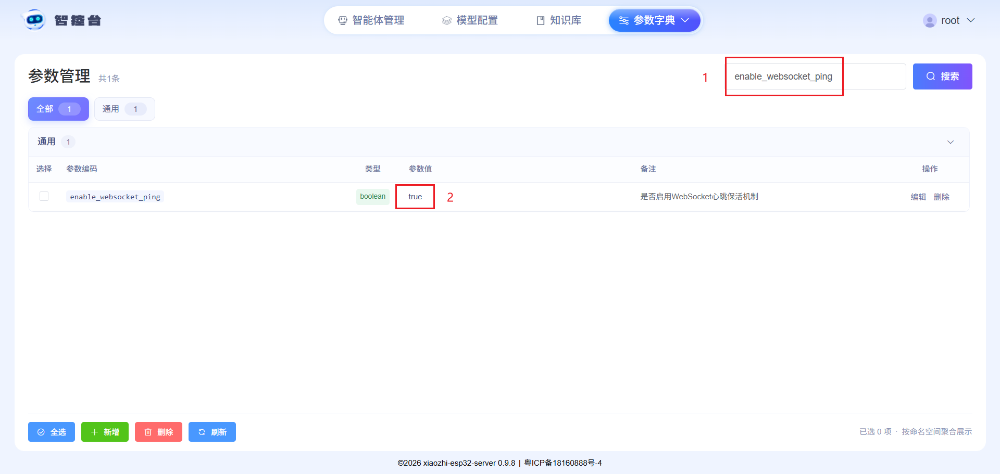

# WebSocket 心跳保活（ping / pong）

客户端定时发送 `ping`，服务端回复 `pong` 并刷新连接活动戳，用于维持长连接、判断链路是否存活。

## 保活用途

- 服务端默认 120 秒（`close_connection_no_voice_time`）内没有收到语音/活动数据就主动挂断连接，客户端在静默期容易被无端切断，心跳可以避免这一点。
- 客户端以是否持续收到 `pong` 判断链路存活，避免出现"页面显示已连接、实际已不可用"的情况。

## 消息格式与字段

客户端 → 服务端：

```json
{ "type": "ping" }
```

服务端 → 客户端：

```json
{ "type": "pong", "timestamp": "2026-11-24 10:20:30" }
```

| 字段 | 说明 |
| --- | --- |
| `type` | 固定为 `ping` / `pong`，服务端按该字段路由到 `PingMessageHandler` |
| `timestamp` | 服务端本地时间，仅用于排查日志，客户端不依赖该字段判断超时 |

## 发送周期

| 项目 | 取值 | 说明 |
| --- | --- | --- |
| `ping` 发送周期 | 10 秒 | 远小于服务端 120 秒静默超时 |
| `pong` 超时阈值 | 30 秒 | 约 3 个心跳周期，超过未收到即判定链路已死 |

- 心跳为 WebSocket 文本帧（JSON），不占用音频二进制通道。
- 客户端以「是否收到过 `pong`」为准：从未收到过不做超时强断（兼容服务端未开启心跳），收到过之后再失联才判定超时。
- 服务端在握手完成（收到 `hello`）后启用心跳，连接关闭或用户挂断时停止并清理定时器。

## 断开后的处理

| 场景 | 触发条件 | 客户端行为 |
| --- | --- | --- |
| 心跳超时 | 收到过 `pong`，此后超过 30 秒未再收到 | 主动关闭连接，并引导用户重新连接 |
| 服务端 / 网络断开 | 连接关闭且非用户主动挂断 | 释放连接、停止录音、清理定时器，并引导用户重新连接 |
| 用户主动挂断 | 用户主动关闭连接 | 静默关闭，不报错 |

提示文案与重连交互由各客户端自行定义（如提示「连接已断开，请重新拨号」），服务端不约束具体措辞。

## 开启方式

心跳默认关闭，服务端收到 `ping` 会直接忽略、不回复 `pong`。需要打开 `enable_websocket_ping` 开关，并重启 `xiaozhi-server` 使配置生效。

在智控台「参数字典 → 参数管理」中操作：

1. 在搜索框输入参数编码 `enable_websocket_ping` 找到该参数（图中 ①）。
2. 确认参数值为 `true`（图中 ②），参数类型为 boolean。
3. 保存后重启 `xiaozhi-server` 服务，配置才会生效。



### 确认生效

服务日志（debug 级别）出现以下内容即表示心跳已开启：

```text
收到PING消息，发送PONG响应
```

若出现 `WebSocket心跳功能未启用，忽略PING消息`，说明配置未生效。
