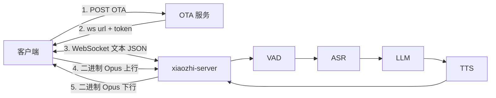
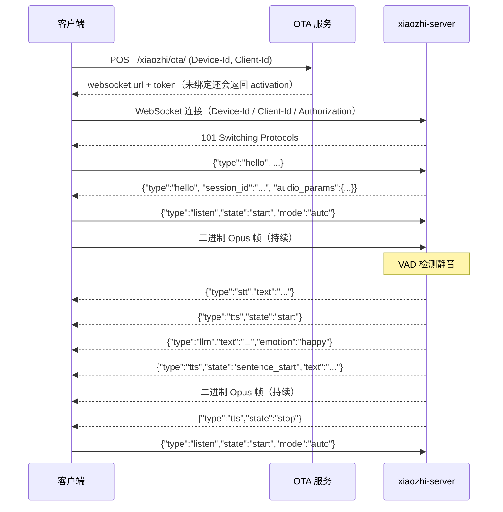
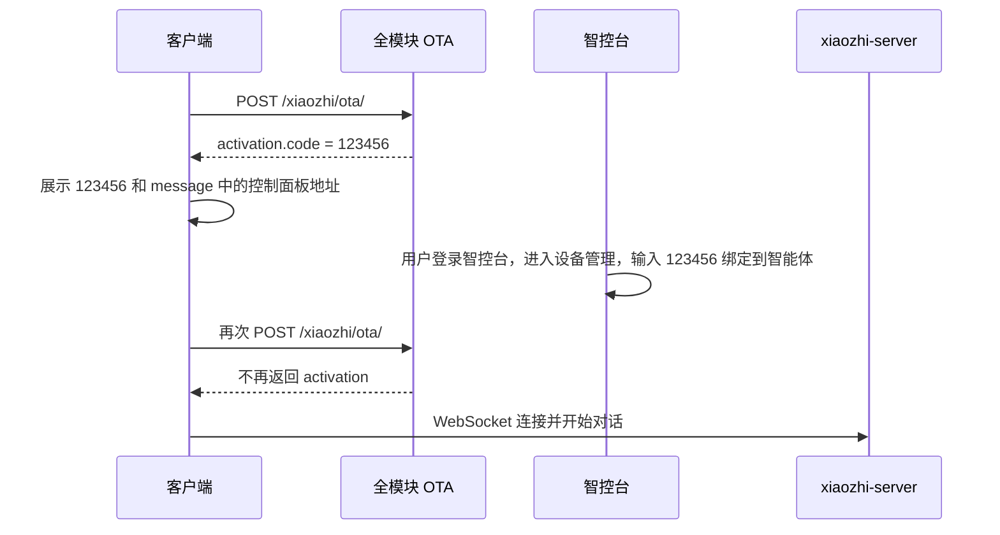
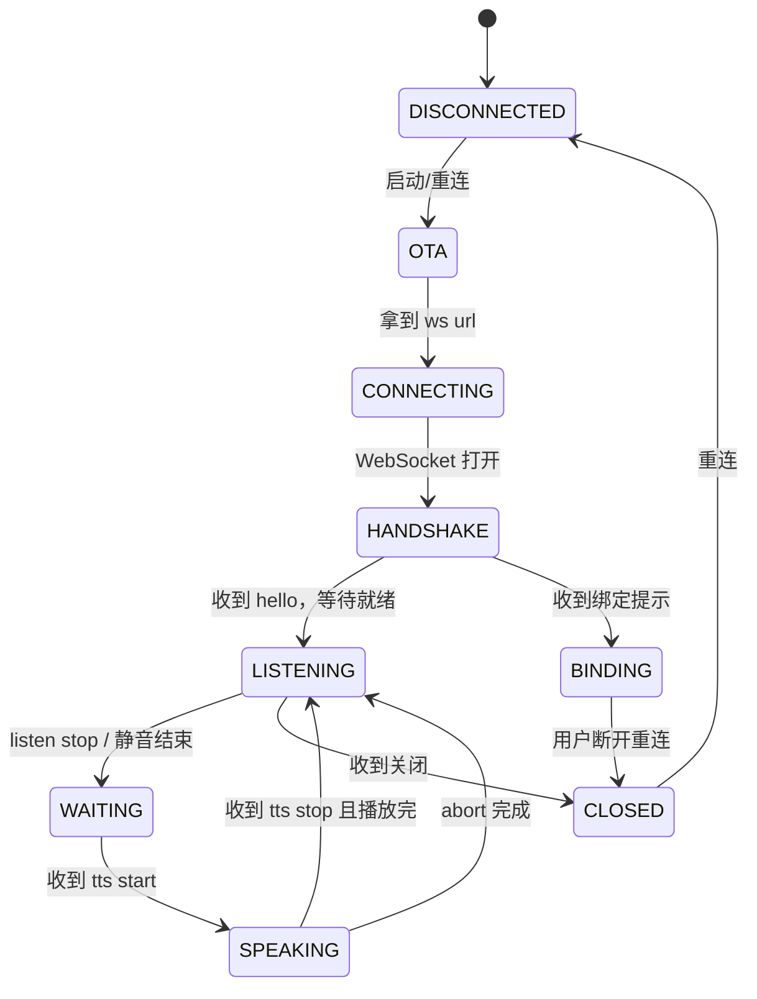
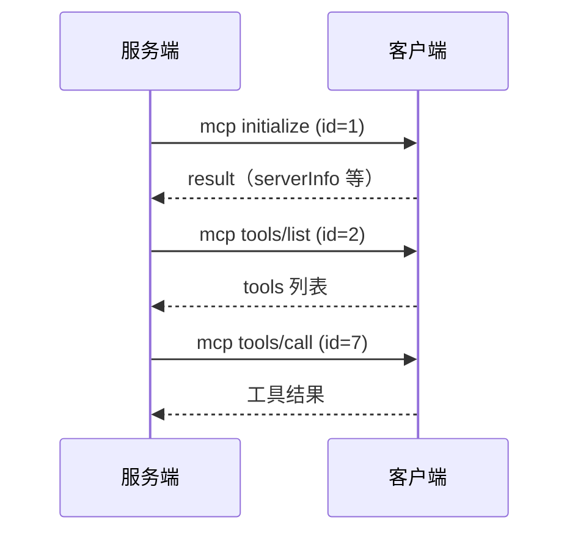

# 小智语音对接说明（客户端接入）

> 项目：`xiaozhi-esp32-server`（dev 分支）
> 适用对象：手机 App、桌面客户端、Web 页面、嵌入式设备等需要接入小智语音能力的客户端开发人员
> 文档依据：本仓库 `main/xiaozhi-server`、`main/manager-api` 与 `main/test-page` 当前代码
> 文档版本：v1.1（2026-10-24，补充 `main/test-page` 的 OTA 与 Token 接入说明）
> 说明：本文描述的是服务端**实际实现**，个别地方与官方通用协议文档存在差异时，以本文和当前代码为准。

---

## 目录

- 0. 一分钟速览
- 1. 接入架构
- 2. 接入前准备
- 3. 端到端流程
- 4. OTA 接口
- 5. WebSocket 建立与鉴权
- 6. 应用层握手 hello
- 7. 音频通道
- 8. 消息协议明细
- 9. 典型交互时序
- 10. 客户端状态机
- 11. 超时、保活与生命周期
- 12. IoT 接入
- 13. MCP 接入
- 14. 错误处理与故障排查
- 15. 联调与测试
- 16. 参考实现
- 17. 接入验收清单
- 附录 A：服务端配置项
- 附录 B：代码位置索引
- 附录 C：一页纸协议速查

---

## 0. 一分钟速览

### 0.1 协议栈

| 项目 | 约定 |
| --- | --- |
| 设备发现 / 地址获取 | HTTP OTA（`POST /xiaozhi/ota/`） |
| 实时通信 | WebSocket（默认 `ws://<host>:8000/xiaozhi/v1/`） |
| 控制消息 | WebSocket 文本帧，UTF-8 JSON |
| 上行音频 | WebSocket 二进制帧，单帧一个 Opus 包 |
| 下行音频 | WebSocket 二进制帧，单帧一个 Opus 包 |
| 上行音频参数 | Opus，16000 Hz，单声道，60 ms/帧（960 样本） |
| 下行音频参数 | Opus，默认 24000 Hz，单声道，60 ms/帧（1440 样本） |
| 鉴权 | 可选，HMAC-SHA256 Token，放在 `Authorization: Bearer <token>` |
| 设备标识 | `Device-Id`，全模块部署时必须是 MAC 格式 |

### 0.2 接入前必须确认的 6 件事

| # | 需要确认 | 从哪里获取 |
| --- | --- | --- |
| 1 | OTA 地址 | 全模块：智控台参数 `server.ota`；单模块：`http://<server>:8003/xiaozhi/ota/` |
| 2 | WebSocket 地址 | OTA 响应中的 `websocket.url`，或智控台参数 `server.websocket` |
| 3 | 是否开启鉴权 | 智控台参数 `server.auth.enabled`，或 Python 配置 `server.auth.enabled` |
| 4 | 服务端 TTS 采样率 | 智控台/Python 配置 `xiaozhi.audio_params.sample_rate`，默认 `24000` |
| 5 | 设备 ID | 客户端自行生成，推荐使用设备 MAC，如 `aa:bb:cc:dd:ee:ff` |
| 6 | 设备是否已绑定 | 全模块部署必须先绑定，否则服务端会丢消息并播放绑定提示 |

> 浏览器端可直接使用仓库内置的 `main/test-page`：OTA 地址选择、Token 获取与刷新都已自动处理，详见 4.6 和 15.2.1。

### 0.3 最短接入路径

```
1. POST OTA，拿到 websocket.url 和 token
2. 建立 WebSocket，携带 Device-Id、Client-Id、Authorization
3. 发送 hello
4. 收到服务端 hello（含 session_id）
5. 发送 listen start
6. 持续发送 Opus 二进制帧
7. 接收 stt / llm / tts / 二进制音频
8. 收到 tts stop 后，重新 listen start，进入下一轮
```

---

## 1. 接入架构

### 1.1 系统组成



| 模块 | 默认端口 | 职责 |
| --- | --- | --- |
| `xiaozhi-server`（Python） | 8000 | WebSocket 长连接、VAD/ASR/LLM/TTS 全链路 |
| `xiaozhi-server` HTTP | 8003 | 单模块部署时的 OTA、视觉分析接口 |
| `manager-api`（Java） | 8002 | 智控台后端、全模块 OTA、设备绑定、配置下发 |
| `manager-web`（Vue） | 8001 | 智控台页面 |
| `digital-human` | 8006 | 官方 Web 测试客户端，可用于联调 |
| `test-page`（静态页面） | 无（`file://` 直接打开） | 零依赖 Web 测试页，内置 OTA 自动获取 Token |

### 1.2 两种接入方式

| 方式 | 传输 | 适用 | 说明 |
| --- | --- | --- | --- |
| WebSocket 直连 | TCP WebSocket | 绝大多数客户端 | 本文重点 |
| MQTT + UDP 网关 | MQTT 控制 + UDP 音频 | 弱网、低功耗设备 | 需额外部署网关，见 `docs/mqtt-gateway-integration.md` |

本文只展开 WebSocket 直连。MQTT 模式下 OTA 会返回 `mqtt` 字段，音频包结构也与 WebSocket 不同，不要混用。

### 1.3 关键参数速查

| 参数 | 值 |
| --- | --- |
| WebSocket 路径 | `/xiaozhi/v1/`（服务端实际不校验路径，但建议固定） |
| 上行采样率 | 16000 Hz |
| 上行声道 | 1（单声道） |
| 上行位深 | 16 bit，小端序 |
| 上行帧长 | 60 ms = 960 样本 = 1920 字节 PCM |
| 下行采样率 | 默认 24000 Hz（以部署配置为准） |
| 下行帧长 | 60 ms |
| 下行 Opus 码率 | 24000 bps（服务端编码器默认） |
| 音频发送节奏 | 前 5 包立即发送，之后每 60 ms 一包 |
| 无语音断开 | 默认 120 s 后触发结束语，180 s 强制断开 |

---

## 2. 接入前准备

### 2.1 服务端参数确认

以下参数在智控台「参数管理」中配置（全模块部署），或在 `main/xiaozhi-server/data/.config.yaml` / `config.yaml` 中配置（单模块部署）。

| 参数 | 作用 | 默认值 |
| --- | --- | --- |
| `server.websocket` | OTA 下发给设备的 WebSocket 地址，多个用 `;` 分隔 | `null` |
| `server.ota` | 全模块 OTA 地址，必须以 `/ota/` 结尾 | `null` |
| `server.auth.enabled` | 是否开启 Token 鉴权 | 全模块默认 `true`，单模块默认 `false` |
| `server.secret` | 鉴权密钥（Python 端最终使用 `server.auth_key`） | 部署时生成 |
| `xiaozhi` | 服务端 hello 的默认内容，含 `audio_params` | `sample_rate=24000` |
| `close_connection_no_voice_time` | 无语音超时秒数 | `120` |
| `enable_websocket_ping` | 是否响应应用层 `ping` | `false` |
| `wakeup_words` | 唤醒词列表 | 「你好小智」等 |
| `exit_commands` | 退出命令 | 「退出」「关闭」 |

Python 端 `server.auth_key` 的取值优先级：

1. 配置文件 `server.auth_key`
2. 全模块部署时取 `manager-api.secret`（即智控台参数 `server.secret`）
3. 以上都没有时启动时随机生成 UUID

所以全模块部署时，OTA 生成的 Token 与 WebSocket 校验使用的是同一个 `server.secret`。

### 2.2 客户端设备标识

| 标识 | 说明 | 建议 |
| --- | --- | --- |
| `Device-Id` | 设备唯一标识。全模块 OTA 会校验 MAC 格式，并以此作为设备绑定 ID | 使用真实 MAC，格式 `aa:bb:cc:dd:ee:ff` 或 `aa-bb-cc-dd-ee-ff` |
| `Client-Id` | 客户端标识，参与 Token 签名。不传时服务端默认等于 `Device-Id` | 与 `Device-Id` 保持一致，或使用固定 App 实例 ID |

全模块 OTA 的 MAC 校验正则：

```text
^([0-9A-Za-z]{2}[:-]){5}([0-9A-Za-z]{2})$
```

注意：

- 不是 MAC 格式的字符串会在全模块 OTA 被拒绝，返回 `{"error":"Invalid device ID"}`。
- 如果客户端没有物理 MAC，可以生成一个本地管理地址，例如 `02:00:00:00:00:01`。
- `Device-Id`、`Client-Id` 在 OTA、Token 生成、WebSocket 连接三个阶段必须保持一致，否则鉴权失败。

### 2.3 地址与端口

| 服务 | 地址示例 |
| --- | --- |
| 全模块 OTA | `http://192.168.1.10:8002/xiaozhi/ota/` |
| 单模块 OTA | `http://192.168.1.10:8003/xiaozhi/ota/` |
| WebSocket | `ws://192.168.1.10:8000/xiaozhi/v1/` |
| 智控台 | `http://192.168.1.10:8001` |

生产环境建议在前面加 Nginx，对外使用 `https://` 和 `wss://`。Python 服务本身默认只监听明文 `ws://`。

注意：智控台参数 `server.websocket`、`server.ota` 必须填写**客户端可达**的局域网 IP 或公网域名，不能填 `127.0.0.1`，否则客户端拿到地址后无法连接。

---

## 3. 端到端流程



---

## 4. OTA 接口

OTA 有两个作用：

1. 下发 WebSocket 地址和鉴权 Token；
2. 返回设备激活码、固件升级信息。

### 4.1 全模块部署（manager-api）

**请求**

```http
POST /xiaozhi/ota/ HTTP/1.1
Host: 192.168.1.10:8002
Content-Type: application/json
Device-Id: aa:bb:cc:dd:ee:ff
Client-Id: aa:bb:cc:dd:ee:ff
```

完整地址：`http://<manager-api>:8002/xiaozhi/ota/`

OTA 只从 **Header** 读取 `Device-Id` / `Client-Id`，不支持 Query 参数传递。

浏览器页面也可以直接请求该接口：`manager-api` 配置了 `allowedOriginPatterns("*")`，会按请求的 `Origin` 回显 CORS 头，因此 `file://` 页面（`Origin: null`）同样可以正常请求。若自建 Nginx 反向代理，请注意不要剥掉 `Access-Control-Allow-Origin`、`Access-Control-Allow-Headers` 等响应头，否则浏览器端 OTA 会失败。

**请求头**

| Header | 必填 | 说明 |
| --- | --- | --- |
| `Device-Id` | 是 | 设备唯一标识，必须是 MAC 格式 |
| `Client-Id` | 否 | 不传时服务端自动取 `Device-Id` |
| `Content-Type` | 是 | `application/json` |

**请求体字段**

| 字段 | 类型 | 必填 | 说明 |
| --- | --- | --- | --- |
| `version` | int | 否 | 固件整数版本号，兼容旧固件 |
| `mac_address` | string | 建议 | 设备 MAC，建议与 `Device-Id` 一致 |
| `uuid` | string | 否 | 设备 UUID |
| `chip_model_name` | string | 否 | 芯片型号名 |
| `application.name` | string | 建议 | 应用名称 |
| `application.version` | string | 建议 | 应用版本号，固件升级比较使用该字段 |
| `application.compile_time` | string | 否 | 编译时间 |
| `application.idf_version` | string | 否 | IDF 版本 |
| `application.elf_sha256` | string | 否 | ELF 校验值 |
| `board.type` | string | 建议 | 设备类型/型号，固件升级按该字段匹配 |
| `board.ssid` | string | 否 | Wi-Fi SSID |
| `board.rssi` | int | 否 | Wi-Fi 信号强度 |
| `board.channel` | int | 否 | Wi-Fi 信道 |
| `board.ip` | string | 否 | 设备 IP |
| `board.mac` | string | 否 | 设备 MAC |
| `chip_info` | object | 否 | 芯片详细信息 |
| `flash_size` | int | 否 | Flash 大小 |
| `minimum_free_heap_size` | int | 否 | 最小空闲堆 |
| `partition_table` | array | 否 | 分区表 |
| `ota.label` | string | 否 | 当前 OTA 分区标签 |

最小可用请求体示例：

```json
{
  "version": 0,
  "uuid": "6f1c2d3e-0000-0000-0000-000000000001",
  "mac_address": "aa:bb:cc:dd:ee:ff",
  "chip_model_name": "generic-client",
  "application": {
    "name": "my-xiaozhi-client",
    "version": "1.0.0"
  },
  "board": {
    "type": "my-xiaozhi-client",
    "mac": "aa:bb:cc:dd:ee:ff"
  }
}
```

**响应字段**

| 字段 | 类型 | 说明 |
| --- | --- | --- |
| `server_time.timestamp` | long | 服务器时间，毫秒 |
| `server_time.timeZone` | string | 时区 ID，如 `Asia/Shanghai` |
| `server_time.timezone_offset` | int | 时区偏移，单位分钟（如 `480`） |
| `websocket.url` | string | WebSocket 地址 |
| `websocket.token` | string | 鉴权 Token，未开启鉴权时为空字符串 |
| `firmware.version` | string | 最新固件版本 |
| `firmware.url` | string | 固件下载地址；无效占位地址表示无需升级 |
| `activation.code` | string | 6 位激活码，仅未绑定设备返回 |
| `activation.message` | string | 控制面板地址 + 换行 + 激活码 |
| `activation.challenge` | string | 挑战码，当前等于 `Device-Id` |
| `mqtt` | object | 配置了 MQTT 网关时返回，包含 `endpoint/client_id/username/password/publish_topic/subscribe_topic` |
| `error` | string | 错误信息，如 `Invalid device ID` |

**已绑定设备的响应示例**

```json
{
  "server_time": {
    "timestamp": 1760000000000,
    "timeZone": "Asia/Shanghai",
    "timezone_offset": 480
  },
  "firmware": {
    "version": "1.0.0",
    "url": "http://xiaozhi.server.com:8002/xiaozhi/otaMag/download/NOT_ACTIVATED_FIRMWARE_THIS_IS_A_INVALID_URL"
  },
  "websocket": {
    "url": "ws://192.168.1.10:8000/xiaozhi/v1/",
    "token": "uQ3...z1.1760000000"
  }
}
```

**未绑定设备的响应示例**

```json
{
  "server_time": {
    "timestamp": 1760000000000,
    "timeZone": "Asia/Shanghai",
    "timezone_offset": 480
  },
  "firmware": {
    "version": "1.0.0",
    "url": "http://xiaozhi.server.com:8002/xiaozhi/otaMag/download/NOT_ACTIVATED_FIRMWARE_THIS_IS_A_INVALID_URL"
  },
  "websocket": {
    "url": "ws://192.168.1.10:8000/xiaozhi/v1/",
    "token": "uQ3...z1.1760000000"
  },
  "activation": {
    "code": "123456",
    "message": "http://xiaozhi.server.com\n123456",
    "challenge": "aa:bb:cc:dd:ee:ff"
  }
}
```

注意：

- 管理器序列化时使用了 `NON_NULL`，没有值的字段不会出现。
- `firmware.url` 等于 `http://xiaozhi.server.com:8002/xiaozhi/otaMag/download/NOT_ACTIVATED_FIRMWARE_THIS_IS_A_INVALID_URL` 时，表示**不需要升级**，不要下载。
- 未绑定设备也会返回 `websocket`，但此时连接上去无法正常对话，必须先完成绑定。

### 4.2 激活与绑定流程（全模块部署）



绑定接口（智控台内部使用）：

```http
POST /xiaozhi/device/bind/{agentId}/{deviceCode}
```

绑定完成后：

- 设备与某个智能体（Agent）建立归属关系；
- 再次请求 OTA 不再返回 `activation`；
- WebSocket 连接后，服务端可以拉取到该设备的私有配置，进入正常对话。

**关键点**：WebSocket 连接建立时如果设备尚未绑定，服务端会进入 `need_bind` 状态，此后该连接会**持续丢弃上行消息**；在收到客户端消息时，最多每 60 秒播放一次绑定提示。绑定完成后，**必须断开 WebSocket 并重新连接**，服务端才会重新拉取配置。连接不会自动恢复。

未绑定时的服务端提示文本：

```text
请登录控制面板，输入{6位绑定码}，绑定设备。
```

如果没有绑定码，则提示：

```text
没有找到该设备的版本信息，请正确配置 OTA地址，然后重新编译固件。
```

### 4.3 单模块部署（Python 端 OTA）

单模块部署且 `read_config_from_api=false` 时，OTA 由 Python 的 8003 端口提供：

```http
POST /xiaozhi/ota/ HTTP/1.1
Host: 192.168.1.10:8003
Content-Type: application/json
Device-Id: aa:bb:cc:dd:ee:ff
Client-Id: aa:bb:cc:dd:ee:ff
```

单模块 OTA **必须同时携带 `Device-Id` 和 `Client-Id`**，缺任意一个都会返回：

```json
{"success": false, "message": "request error."}
```

响应示例：

```json
{
  "server_time": {
    "timestamp": 1760000000000,
    "timezone_offset": 480
  },
  "firmware": {
    "version": "1.0.0",
    "url": ""
  },
  "websocket": {
    "url": "ws://192.168.1.10:8000/xiaozhi/v1/",
    "token": ""
  }
}
```

与全模块的差异：

| 项目 | 全模块 | 单模块 |
| --- | --- | --- |
| OTA 端口 | `8002/xiaozhi/ota/` | `8003/xiaozhi/ota/` |
| 激活码 | 有 | 无 |
| 设备绑定 | 必须 | 不涉及 |
| Token | `server.secret` 生成 | `server.auth_key` 生成 |
| 固件匹配 | `board.type` + `application.version` | 默认按 `board.type`，文件名 `{model}_{version}.bin` |
| 固件下载 | `/otaMag/download/{uuid}` | `/xiaozhi/ota/download/{filename}` |

单模块 OTA 的 GET 健康检查：

```http
GET /xiaozhi/ota/ HTTP/1.1
```

返回：

```text
OTA接口运行正常，向设备发送的websocket地址是：ws://192.168.1.10:8000/xiaozhi/v1/
```

全模块 OTA 的 GET 返回文本依赖 `server.mqtt_gateway` 等参数，提示“缺少 mqtt_gateway 地址”并不代表 POST OTA 不可用；实际接入请以 POST 结果为准。

### 4.4 固件升级

| 场景 | 行为 |
| --- | --- |
| 设备未绑定 | 不返回升级地址，`firmware.url` 为无效占位地址 |
| 设备已绑定且关闭自动升级 | 不返回 `firmware` |
| 设备已绑定且开启自动升级 | 有更新时返回下载地址，无更新时返回无效占位地址 |
| 版本比较 | 按 `board.type` 匹配固件，按点分版本号逐段比较 |

客户端处理建议：

1. 只有 `firmware.url` 非空且不等于无效占位地址时才下载；
2. 下载完成后校验版本号；
3. 升级重启后重新走 OTA 和 WebSocket 流程。

### 4.5 OTA 常见错误

| 响应 | 原因 |
| --- | --- |
| `{"error":"Device ID is required"}` | 缺少 `Device-Id` 请求头 |
| `{"error":"Invalid device ID"}` | `Device-Id` 不是 MAC 格式 |
| HTTP 202 + 空响应 | 调用 `/ota/activate` 快速检查时设备不存在 |
| 返回 `mqtt` 而不是可用的 `websocket` | 服务端配置了 MQTT 网关，客户端需要改用 MQTT 接入 |

### 4.6 浏览器端 OTA 接入（`test-page` 参考实现）

仓库内置的 [test-page](../main/test-page/index.html) 是零依赖静态页面，可直接双击 `index.html` 打开（`file://`），其 OTA 与 Token 处理可直接作为浏览器客户端参考：

1. **设备 ID**：浏览器无法直接读取网卡 MAC，页面会生成 `02:xx:xx:xx:xx:xx` 形式的虚拟 MAC（首字节带本地管理位），保存在 `localStorage`，刷新后固定不变；也可手动修改。
2. **OTA 地址**：默认请求 `http://<host>:8002/xiaozhi/ota/`（全模块）；失败后自动再试 `http://<host>:8003/xiaozhi/ota/`（单模块）。页面上的“OTA 地址”输入框可手动覆盖。
3. **请求方式**：`POST`，Header 携带 `Device-Id`、`Client-Id`（两者相同），Body 使用最小设备上报结构（`application`、`board`、`mac_address` 等）。
4. **Token**：读取响应 `websocket.token`，自动填入页面，并拼到 WebSocket 查询参数 `authorization=Bearer <token>`；未开启鉴权时 Token 为空，直接连接。
5. **WebSocket 地址**：优先使用响应 `websocket.url`；如果它是占位地址 `ws://xiaozhi.server.com...`（智控台 `server.websocket` 未配置时会返回），则沿用页面中的本地地址 `ws://127.0.0.1:8000/xiaozhi/v1/`。
6. **未绑定设备**：响应带 `activation.code` 时，页面会提示激活码；此时连接能建立，但服务端会丢弃上行消息并播放绑定提示，绑定后必须重新连接。
7. **OTA 失败**：页面回退到“手动地址 + 手动 Token”连接，并在协议日志中给出失败原因。

关键行为对照：

| 场景 | test-page 行为 |
| --- | --- |
| 8002 OTA 正常 | 自动获取 `websocket.url` / `token` |
| 8002 不可用 | 自动尝试 8003 |
| `websocket.url` 为占位地址 | 忽略，使用页面 WebSocket 地址 |
| `activation.code` 存在 | 展示激活码，提示先绑定 |
| `websocket.token` 为空 | 不带 `authorization` 连接 |
| OTA 全部失败 | 使用页面已填写的地址与 Token |

注意：

- Token 有效期 30 天，页面每次点击“连接”都会重新请求 OTA，因此无需客户端自行处理 Token 过期。
- 页面通过 `file://` 打开时，Chromium 系浏览器不允许加载 blob AudioWorklet，页面会自动降级为 `ScriptProcessorNode` 采集，行为与 `AudioWorklet` 一致，仅 CPU 占用略高。
- 麦克风需要安全上下文：`file://` 在 Chromium 中可用，但部分浏览器会限制；如遇麦克风不可用，可改用 `http://127.0.0.1` 或 `https` 静态服务访问。

---

## 5. WebSocket 建立与鉴权

### 5.1 连接地址

```text
ws://<host>:8000/xiaozhi/v1/
```

服务端 `websockets.serve(..., ping_interval=None)`，监听地址来自 `server.ip` / `server.port`，默认 `0.0.0.0:8000`。

路径本身不参与路由判断，但建议统一使用 `/xiaozhi/v1/`，便于网关转发和排查。

### 5.2 认证信息传递方式

服务端支持两种方式，二选一，**不要混用**。

#### 方式 A：HTTP Header（推荐）

```http
GET /xiaozhi/v1/ HTTP/1.1
Host: 192.168.1.10:8000
Upgrade: websocket
Connection: Upgrade
Sec-WebSocket-Key: <随机值>
Sec-WebSocket-Version: 13
Device-Id: aa:bb:cc:dd:ee:ff
Client-Id: aa:bb:cc:dd:ee:ff
Authorization: Bearer <token>
```

| Header | 必填 | 说明 |
| --- | --- | --- |
| `Device-Id` | 是 | 设备唯一标识 |
| `Client-Id` | 否 | 不传时服务端默认等于 `Device-Id`，但 Token 签名必须与生成时一致 |
| `Authorization` | 开启鉴权时必填 | 必须以 `Bearer ` 开头 |

#### 方式 B：URL 查询参数

```text
ws://192.168.1.10:8000/xiaozhi/v1/?device-id=aa%3Abb%3Acc%3Add%3Aee%3Aff&client-id=aa%3Abb%3Acc%3Add%3Aee%3Aff&authorization=Bearer%20<token>
```

服务端只在**没有 `Device-Id` 请求头**时，才会从查询参数中读取 `device-id`、`client-id`、`authorization`。

因此：

- 要么全部用 Header；
- 要么全部用 Query；
- 如果 Header 里带了 `Device-Id`，Query 里的 `authorization` 不会被读取。

### 5.3 Token 生成算法

Token 与服务端 `core/auth.py` 的实现一致：

```text
content = client_id + "|" + device_id + "|" + timestamp（秒）
signature = Base64URL(HMAC-SHA256(secret, content))，去掉末尾 '='
token = signature + "." + timestamp
```

Python 示例：

```python
import base64
import hashlib
import hmac
import time


def make_token(secret: str, client_id: str, device_id: str) -> str:
    ts = int(time.time())
    content = f"{client_id}|{device_id}|{ts}"
    sig = hmac.new(
        secret.encode("utf-8"),
        content.encode("utf-8"),
        hashlib.sha256,
    ).digest()
    signature = base64.urlsafe_b64encode(sig).decode("utf-8").rstrip("=")
    return f"{signature}.{ts}"
```

校验规则：

| 规则 | 说明 |
| --- | --- |
| 签名内容 | `client_id|device_id|timestamp`，顺序不能变 |
| 时间戳 | 秒级 Unix 时间戳 |
| 有效期 | 默认 30 天，由 `server.auth.expire_seconds` 控制 |
| 编码 | Base64URL，无填充 |
| 传输 | `Authorization: Bearer <token>` |

**实践建议**：客户端不要内置 `server.secret`。优先通过 OTA 获取 `websocket.token`，OTA 返回的 token 不带 `Bearer ` 前缀，连接时补上即可。

### 5.4 鉴权行为

| 服务端配置 | 客户端行为 |
| --- | --- |
| `server.auth.enabled = false` | 不需要 Token，直接连接 |
| `server.auth.enabled = true`，设备在白名单 | 不需要 Token |
| `server.auth.enabled = true`，设备不在白名单 | 必须带合法 Token |
| 全模块部署（鉴权开启时） | 白名单为空，必须带 Token |

Python 单模块的 `server.auth.allowed_devices` 支持白名单；全模块部署时该配置不会下发，白名单不生效。

### 5.5 连接失败的服务端返回

| 现象 | 原因 |
| --- | --- |
| 收到文本 `认证失败` 后连接关闭（浏览器通常显示 `code=1000`） | Token 缺失、格式错误、签名错误或已过期；服务端主动 `close()` 未指定关闭码，默认即 1000 |
| 收到文本 `端口正常，如需测试连接，请启动digital-human测试` 后连接关闭 | 既没有 `Device-Id` Header，也没有 `device-id` Query |
| 普通 HTTP GET 返回 `Server is running` | 正常，说明 8000 端口 HTTP 服务在工作 |

注意：WebSocket `code=1000` 表示“正常关闭”，既可能是服务端鉴权失败后主动关闭，也可能是客户端主动断开。判断依据是关闭前是否收到 `认证失败` 文本。

### 5.6 TLS / WSS

Python 服务默认不启用 TLS。生产环境建议：

```text
客户端 --wss://--> Nginx --ws://--> xiaozhi-server:8000
```

Nginx 关键配置：

```nginx
location /xiaozhi/v1/ {
    proxy_pass http://127.0.0.1:8000;
    proxy_http_version 1.1;
    proxy_set_header Upgrade $http_upgrade;
    proxy_set_header Connection "upgrade";
    proxy_set_header Host $host;
    proxy_read_timeout 3600s;
    proxy_send_timeout 3600s;
}
```

浏览器麦克风要求安全上下文，Web 客户端在生产环境必须使用 `https://` + `wss://`（`localhost` 除外）。

---

## 6. 应用层握手 hello

WebSocket 建立后，客户端必须立即发送一条 `hello` 文本消息。服务端不会主动下发 hello。

### 6.1 客户端 hello

```json
{
  "type": "hello",
  "version": 1,
  "transport": "websocket",
  "audio_params": {
    "format": "opus",
    "sample_rate": 16000,
    "channels": 1,
    "frame_duration": 60
  },
  "features": {
    "mcp": false,
    "aec": false,
    "emoji": true
  }
}
```

| 字段 | 必填 | 说明 |
| --- | --- | --- |
| `type` | 是 | 固定 `hello` |
| `version` | 建议 | 协议版本，当前为 `1`；服务端未做校验 |
| `transport` | 建议 | 固定 `websocket`；服务端未做校验 |
| `audio_params.format` | 建议 | `opus` 或 `pcm`，影响服务端下行编码 |
| `audio_params.sample_rate` | 建议 | 客户端上报值，服务端会回显，但不作为 TTS 实际编码采样率 |
| `audio_params.channels` | 建议 | 固定 `1` |
| `audio_params.frame_duration` | 建议 | 固定 `60` |
| `features.mcp` | 否 | `true` 表示客户端支持 MCP，服务端随后下发 MCP 初始化 |
| `features.aec` | 否 | `true` 表示启用服务端 AEC（主要面向 MQTT 网关连接） |
| `features.emoji` | 否 | `false` 时不接收 `llm` 情绪消息；默认 `true` |

### 6.2 服务端 hello 响应

```json
{
  "type": "hello",
  "version": 1,
  "transport": "websocket",
  "audio_params": {
    "format": "opus",
    "sample_rate": 16000,
    "channels": 1,
    "frame_duration": 60
  },
  "session_id": "6f1c2d3e-4a5b-6c7d-8e9f-000000000001"
}
```

字段说明：

| 字段 | 说明 |
| --- | --- |
| `session_id` | 本次连接的服务端会话 ID，后续下行消息都会携带 |
| `audio_params` | 客户端上报值的回显；客户端没上报时使用服务端默认配置 |
| `version` / `transport` | 来自服务端默认 hello 配置 |

### 6.3 三个必须注意的点

#### 1. 下行采样率不要直接依赖回显值

服务端在连接建立时就从部署配置读取 TTS 采样率：

```python
self.sample_rate = self.welcome_msg["audio_params"]["sample_rate"]
```

随后 `hello` 处理又会把客户端上报的 `audio_params` 回显到 hello 响应里，但**不会回写 `conn.sample_rate`**。

因此：

- 上行：固定按 16000 Hz Opus 发送；
- 下行：按**服务端部署配置** `xiaozhi.audio_params.sample_rate` 解码，默认 `24000`；
- 如果客户端必须使用其他下行采样率，需要让服务端修改配置并重启，而不是只在 hello 里上报；
- 配置变更只对之后新建的连接生效，修改后客户端应重新连接。

#### 2. 握手后不要立刻灌音频

服务端在发送 hello 之后才在后台异步加载设备私有配置。`_route_message` 最多等待 1 秒；超时仍未加载完成时，这条消息会被直接丢弃。建议：

- 收到服务端 hello 后至少等待 1 秒；
- 再发送 `listen start`；
- 全模块部署首次连接、或服务端配置接口较慢时，建议等待 1.5 秒；
- 如果连接后 2 ~ 3 秒仍未收到服务端 hello，重发一次 `hello`（配置加载完成前，服务端可能连 hello 都来不及处理）；
- 如果第一轮没有响应，客户端可以重发一次 `listen start`，而不是直接判定连接失败。

#### 3. MCP 初始化由服务端主动发起

如果 `features.mcp = true`，服务端在 hello 之后立即下发：

```json
{
  "type": "mcp",
  "payload": {
    "jsonrpc": "2.0",
    "id": 1,
    "method": "initialize",
    "params": {
      "protocolVersion": "2024-11-05",
      "capabilities": {
        "roots": {"listChanged": true},
        "sampling": {},
        "vision": {
          "url": "http://<server>:8003/mcp/vision/explain",
          "token": "<vision token>"
        }
      },
      "clientInfo": {
        "name": "XiaozhiClient",
        "version": "1.0.0"
      }
    }
  }
}
```

不支持 MCP 的客户端请把 `features.mcp` 设为 `false` 或省略。

---

## 7. 音频通道

### 7.1 上行音频（客户端 → 服务端）

服务端对每个二进制帧的处理：

```python
pcm_frame = opus_decoder.decode(opus_packet, 960)
```

其中解码器固定为：

```python
opuslib_next.Decoder(16000, 1)
```

**必须满足的参数**

| 参数 | 要求 |
| --- | --- |
| 编码格式 | Opus |
| 采样率 | 16000 Hz |
| 声道 | 1（单声道） |
| 每帧时长 | 60 ms |
| 每帧 PCM 样本数 | 960 |
| 每帧 PCM 字节数 | 1920（16 bit） |
| WebSocket 帧类型 | 二进制 |
| 每帧内容 | 1 个完整 Opus 包，无任何头部、长度前缀、分隔符 |

**编码器建议**

| 参数 | 建议值 |
| --- | --- |
| Application | `OPUS_APPLICATION_AUDIO` 或 `OPUS_APPLICATION_VOIP`（opuslib 中为 `APPLICATION_AUDIO` / `APPLICATION_VOIP`） |
| 码率 | 16000 ~ 24000 bps |
| 复杂度 | 5 ~ 10 |
| VBR | 可开启 |
| 丢包隐藏 | 可开启 |

**不要做的事**

- 不要把多帧 Opus 拼成一个 WebSocket 消息；
- 不要发送 20 ms / 40 ms 帧（服务端按 60 ms、960 样本解码，其他帧长未保证兼容）；
- 不要发送 WAV、MP3、AAC、PCM 原始数据；
- 不要 Base64 编码；
- 不要在二进制帧里加自定义头。

**发送节奏**

- 按实时节奏发送，约每 60 ms 一帧；
- 允许短时抖动，但不要一次灌入几十秒音频；
- 在 `listen start` 之前不要发送音频，服务端可能直接丢弃。

### 7.2 下行音频（服务端 → 客户端）

服务端 TTS 编码参数：

| 参数 | 值 |
| --- | --- |
| 编码 | Opus |
| 采样率 | `conn.sample_rate`，默认 24000 Hz |
| 声道 | 1 |
| 帧时长 | 60 ms |
| 每帧样本数 | 1440（24 kHz） |
| 码率 | 24000 bps |
| 复杂度 | 10 |
| 信号类型 | `SIGNAL_VOICE` |
| 应用类型 | `APPLICATION_AUDIO` |
| WebSocket 帧类型 | 二进制 |

因此客户端解码器应初始化为：

```text
Opus Decoder(sample_rate = 服务端部署的 xiaozhi.audio_params.sample_rate, channels = 1)
```

默认 24000 Hz 时，每帧解码出 1440 个 16 bit 样本。解码后的 PCM 需要重采样到设备实际播放采样率（常见 44100 或 48000）。

**二进制帧语义**

- 一个 WebSocket 二进制消息 = 一个 Opus 包；
- 消息之间没有序号、时间戳、长度字段；
- 音频包与 `tts` 文本消息交错到达，但顺序稳定；
- 收到 `tts stop` 后不会再有本轮音频。

**发送节奏与预缓冲**

服务端使用 `AudioRateController` 控制节奏：

- 每轮前 5 个包立即发送；
- 之后每 60 ms 发送一个包；
- 如果配置了 `tts_audio_send_delay > 0`，则按固定延迟发送，不再预缓冲。

客户端建议：

1. 收到首批 3 ~ 5 个包后再开始播放，降低抖动；
2. 播放队列持续消费；
3. 收到 `tts stop` 后继续播放完队列，再回到聆听状态；
4. 收到 `abort` 触发的 `tts stop` 时，立即清空播放队列。

### 7.3 PCM 下行模式

如果客户端在 hello 中上报：

```json
{"audio_params":{"format":"pcm","sample_rate":16000,"channels":1,"frame_duration":60}}
```

服务端会改为发送 PCM 二进制数据：

- 16 bit 小端序；
- 单声道；
- 采样率仍为服务端 `conn.sample_rate`（默认 24000）；
- 每包 60 ms，即 1440 样本、2880 字节。

PCM 模式省去 Opus 解码，但带宽明显增大，不建议在公网使用。

**注意**：上行始终按 Opus 处理，`format: pcm` 只影响下行。

### 7.4 回声与打断

| 场景 | 服务端行为 |
| --- | --- |
| `features.aec = false`，自动模式 | 服务端仍会做 VAD/ASR；用户说话并完成识别后，新问题会打断当前播报 |
| `features.aec = true` | 服务端在检测到用户语音时可直接打断当前播报；AEC 处理主要用于 MQTT 网关音频 |
| `mode = manual` | 服务端不自动打断播报，客户端必须显式发送 `abort` |

客户端最佳实践：

1. 播报期间可以继续采集，用于本地打断判断；
2. 本地检测到有效人声后，先发送 `abort`，再清空播放队列；
3. 如果不希望本地回声触发打断，播报期间暂停上行音频，或在服务端开启 AEC；
4. 打断后重新发送 `listen start`，再开始上传音频。

---

## 8. 消息协议明细

### 8.1 通用约定

| 项目 | 约定 |
| --- | --- |
| 编码 | UTF-8 |
| 格式 | JSON 对象 |
| 文本帧 | 控制消息 |
| 二进制帧 | 音频 |
| `type` | 消息类型，必填 |
| `session_id` | 下行消息必带；上行消息可选，服务端当前不校验 |
| 未知 `type` | 服务端记录日志后忽略，不回复 |
| 非 JSON 文本 | 服务端记录日志后**原样回显**给客户端 |
| 空二进制帧 | 服务端忽略 |

如果客户端收到一条和自己发送内容完全一样的文本消息，说明刚才发送的不是合法 JSON。

关于 `session_id`：

- 每次 WebSocket 连接生成一个，整条连接期间不变；
- 不是每轮对话变化；
- 客户端不要用 `session_id` 区分对话轮次，应以 `tts start` / `tts stop` 为界；
- 上行消息里的 `session_id` 服务端当前不解析。

### 8.2 客户端 → 服务端

#### 8.2.1 `hello`

见第 6 章。

#### 8.2.2 `listen`

启动、停止拾音，或注入文本。

**开始拾音**

```json
{
  "type": "listen",
  "state": "start",
  "mode": "auto"
}
```

| 字段 | 必填 | 说明 |
| --- | --- | --- |
| `state` | 是 | `start` |
| `mode` | 否 | `auto`（默认）、`manual`、`realtime` |

服务端行为：

- 清空音频缓冲、VAD 状态、ASR 状态；
- `manual` 模式下服务端不做 VAD，所有音频都缓存，直到收到 `listen stop`；
- `auto` / `realtime` 模式下由服务端 VAD 判断一句话结束；
- 服务端只对 `manual` 做特殊处理，`realtime` 目前与 `auto` 行为一致。

**停止拾音**

```json
{
  "type": "listen",
  "state": "stop"
}
```

服务端行为：

- `manual` 模式：对已缓存音频执行 ASR；
- `auto` 模式：流式 ASR 会收到结束请求；非流式 ASR 在 VAD 结束时已经触发；
- 如果 ASR 尚未初始化，该消息会被忽略。

**注入文本 / 唤醒词**

```json
{
  "type": "listen",
  "state": "detect",
  "text": "今天天气怎么样"
}
```

| 字段 | 必填 | 说明 |
| --- | --- | --- |
| `state` | 是 | `detect` |
| `text` | 否 | 要注入的文本；不传时仅重置音频状态 |

服务端行为：

- 重置音频状态；
- 如果 `text` 命中 `wakeup_words`，按唤醒词逻辑处理；
- 如果 `text` 以 `[device_call]` 开头，进入来电接听模式；
- 否则把 `text` 直接交给 LLM 生成回复。

文本输入不需要上传音频。

#### 8.2.3 `abort`

打断当前 LLM/TTS 输出。

```json
{
  "type": "abort",
  "reason": "wake_word_detected"
}
```

| 字段 | 必填 | 说明 |
| --- | --- | --- |
| `type` | 是 | `abort` |
| `reason` | 否 | 原因说明，服务端当前不解析 |
| `session_id` | 否 | 服务端当前不校验 |

服务端行为：

1. 设置 `client_abort = true`；
2. 清空 TTS 文本队列和音频队列；
3. 停止音频发送循环；
4. 回复一条 `tts stop`；
5. 清除“服务端正在说话”状态。

#### 8.2.4 `iot`

上报设备能力描述和状态。

见第 12 章。

#### 8.2.5 `mcp`

回复服务端发起的 MCP 请求。

见第 13 章。

#### 8.2.6 `ping`

应用层心跳。

```json
{"type": "ping"}
```

服务端响应：

```json
{
  "type": "pong",
  "timestamp": "2026-10-24 12:00:00"
}
```

前提：服务端配置 `enable_websocket_ping = true`。默认关闭，关闭时服务端**静默忽略** `ping`，不会回复。

注意：服务端 WebSocket 本身设置了 `ping_interval=None`，不会主动发送 WebSocket 协议层 Ping 帧。客户端需要自行做连接存活检测。

#### 8.2.7 `server`（管理指令，普通客户端不需要）

```json
{
  "type": "server",
  "action": "update_config",
  "content": {"secret": "<server.secret>"}
}
```

仅在 `read_config_from_api = true` 时有效，且 `content.secret` 必须等于服务端配置的密钥。支持：

| action | 说明 |
| --- | --- |
| `update_config` | 重新从 manager-api 拉取配置 |
| `restart` | 重启 Python 服务 |

普通客户端不要发送该消息。

### 8.3 服务端 → 客户端

#### 8.3.1 `hello`

见第 6 章。

#### 8.3.2 `stt`

语音识别结果或工具调用提示。

```json
{
  "type": "stt",
  "text": "今天天气怎么样",
  "session_id": "6f1c2d3e-4a5b-6c7d-8e9f-000000000001"
}
```

| 字段 | 说明 |
| --- | --- |
| `text` | 识别文本，已去除首尾标点和 emoji |
| `session_id` | 当前会话 ID |

`text` 也可能不是用户原话：

- 工具调用开始时，服务端可能发送 `% function_name` 作为状态提示；
- 绑定提示、结束语等也会通过 `stt` 下发。

#### 8.3.3 `llm`

情绪消息，通常在模型开始输出文本时发送一条；如果本轮触发工具调用，工具结果后的二次回答也可能再次发送。

```json
{
  "type": "llm",
  "text": "🙂",
  "emotion": "happy",
  "session_id": "6f1c2d3e-4a5b-6c7d-8e9f-000000000001"
}
```

仅当 `features.emoji` 不为 `false` 时下发。`emotion` 可用于驱动 UI 表情或数字人动作。

注意：`llm` 消息的 `text` 是 emoji，不是模型的完整回答。模型的回复文本通过后续 `tts sentence_start` 分段下发。如果只需要在界面上展示回答，请使用 `sentence_start.text`，不要把 `llm.text` 当作回答正文。

情绪映射：

| emoji | emotion | emoji | emotion |
| --- | --- | --- | --- |
| 😂 | funny | 😭 | crying |
| 😠 | angry | 😔 | sad |
| 😍 | loving | 😲 | surprised |
| 😱 | shocked | 🤔 | thinking |
| 😌 | relaxed | 😴 | sleepy |
| 😜 | silly | 🙄 | confused |
| 😶 | neutral | 🙂 | happy |
| 😆 | laughing | 😳 | embarrassed |
| 😉 | winking | 😎 | cool |
| 🤤 | delicious | 😘 | kissy |
| 😏 | confident | | |

#### 8.3.4 `tts`

TTS 状态消息。

**开始播报**

```json
{
  "type": "tts",
  "state": "start",
  "session_id": "6f1c2d3e-4a5b-6c7d-8e9f-000000000001"
}
```

**句子开始**

```json
{
  "type": "tts",
  "state": "sentence_start",
  "text": "今天天气不错",
  "session_id": "6f1c2d3e-4a5b-6c7d-8e9f-000000000001"
}
```

`sentence_start` 后紧跟该句的二进制音频帧。文本已去除 emoji 和换行。

**结束**

```json
{
  "type": "tts",
  "state": "stop",
  "session_id": "6f1c2d3e-4a5b-6c7d-8e9f-000000000001"
}
```

语义：

- 本轮所有文本和音频已发送完毕；
- 服务端尾部还等待了约 420 ms（预缓冲包播放时间），才发送 `stop`；
- 客户端播放队列中可能仍有音频，需要继续播放完；
- 客户端主动 `abort` 时，服务端也会回复 `tts stop`，此时应立即清空播放队列。

服务端**不会**发送 `sentence_end`。如果客户端需要按句统计，请在收到下一条 `sentence_start` 或 `stop` 时自行结束上一句。

#### 8.3.5 二进制音频

- 类型：WebSocket 二进制帧；
- 内容：一个 Opus 包（PCM 模式下是一个 PCM 数据块）；
- 没有额外字段；
- 按第 7 章参数解码。

#### 8.3.6 `iot`

```json
{
  "type": "iot",
  "commands": [
    {
      "name": "Lamp",
      "method": "set_power",
      "parameters": {"power": true}
    }
  ]
}
```

客户端执行后，应通过 `iot states` 回传最新状态。

#### 8.3.7 `mcp`

服务端发起的 MCP 请求：

```json
{
  "type": "mcp",
  "payload": {
    "jsonrpc": "2.0",
    "id": 2,
    "method": "tools/list"
  }
}
```

客户端需要按第 13 章回复。

#### 8.3.8 `pong`

```json
{
  "type": "pong",
  "timestamp": "2026-10-24 12:00:00"
}
```

仅在客户端发 `ping` 且服务端开启心跳时返回。

#### 8.3.9 `server`

```json
{
  "type": "server",
  "status": "success",
  "message": "配置更新成功",
  "content": {"action": "update_config"}
}
```

普通客户端可以忽略，或用于展示服务端管理操作结果。

#### 8.3.10 纯文本错误

以下情况服务端发送的是**纯文本**，不是 JSON：

| 文本 | 场景 |
| --- | --- |
| `认证失败` | 鉴权失败，随后关闭连接 |
| `端口正常，如需测试连接，请启动digital-human测试` | 缺少设备 ID，随后关闭连接 |

客户端必须判断消息是否为 JSON，不能直接 `JSON.parse`。

### 8.4 消息类型总表

| 方向 | type | 作用 | 是否必须 |
| --- | --- | --- | --- |
| C→S | `hello` | 应用层握手 | 必须 |
| C→S | `listen` | 开始/停止拾音、文本注入 | 必须 |
| C→S | `abort` | 打断播报 | 按需 |
| C→S | `iot` | 上报 IoT 描述/状态 | 可选 |
| C→S | `mcp` | 回复 MCP 请求 | 可选 |
| C→S | `ping` | 应用层心跳 | 可选 |
| C→S | `server` | 管理指令 | 普通客户端不用 |
| S→C | `hello` | 握手响应，返回 session_id | 必须 |
| S→C | `stt` | 识别文本/状态提示 | 必须 |
| S→C | `llm` | 情绪 | 可选 |
| S→C | `tts` | 播报状态 | 必须 |
| S→C | 二进制 | Opus/PCM 音频 | 必须 |
| S→C | `iot` | IoT 控制命令 | 可选 |
| S→C | `mcp` | MCP 请求 | 可选 |
| S→C | `pong` | 心跳响应 | 可选 |
| S→C | `server` | 管理结果 | 可选 |
| S→C | 纯文本 | 错误提示 | 异常时 |

---

## 9. 典型交互时序

### 9.1 自动模式语音对话（最常用）

```text
客户端                                              服务端
  |                                                   |
  |-- hello ----------------------------------------->|
  |<---------------------------------------- hello ---|
  |                                                   |
  |-- {"type":"listen","state":"start","mode":"auto"}->|
  |-- Opus 帧 1 ------------------------------------->|
  |-- Opus 帧 2 ------------------------------------->|
  |-- ...                                             |
  |                                                   | VAD 检测到静音达到配置阈值
  |<-------------------------------- stt（用户文本）---|
  |<-------------------------------- tts start --------|
  |<-------------------------------- llm（情绪，可选）--|
  |<-------------------------- tts sentence_start -----|
  |<-------------------------------- Opus 音频帧 ------|
  |<-------------------------------- Opus 音频帧 ------|
  |<-------------------------------- tts stop ---------|
  |                                                   |
  |-- {"type":"listen","state":"start","mode":"auto"}->|
  |-- Opus 帧 --------------------------------------->|
```

关键顺序：

1. `stt` 先到；
2. `tts start` 随后到；
3. `llm` 情绪消息时间不固定，可能在 `tts start` 前或后；
4. `sentence_start` 后紧接音频；
5. `tts stop` 是整轮结束标志。

VAD 静音阈值由服务端部署配置决定，客户端不要硬编码固定时长：

| 部署方式 | `threshold` | `threshold_low` | `min_silence_duration_ms` |
| --- | --- | --- | --- |
| 单模块 `config.yaml` | `0.5` | `0.3` | `200` |
| 全模块智控台默认 | `0.5` | `0.2` | `700` |

该值越大，等待用户停顿的时间越长。

### 9.2 手动 / 按键模式

```text
客户端                                              服务端
  |-- hello ----------------------------------------->|
  |<---------------------------------------- hello ---|
  |-- {"type":"listen","state":"start","mode":"manual"}->|
  |-- Opus 帧（按下说话）---------------------------->|
  |-- Opus 帧（松开前）------------------------------>|
  |-- {"type":"listen","state":"stop"} --------------->|
  |                                                   | 对缓存音频执行 ASR
  |<-------------------------------- stt -------------|
  |<-------------------------------- tts start -------|
  |<-------------------------------- 音频帧 ----------|
  |<-------------------------------- tts stop --------|
```

手动模式特点：

- 服务端不做 VAD，所有上行音频都进入 ASR；
- 不会自动打断正在播放的 TTS；
- 客户端必须在用户松开按键时发送 `listen stop`；
- 建议只发送有效语音和少量尾部静音，避免把长时间静音送入 ASR。

### 9.3 打断播报

**客户端主动打断**

```text
客户端                                              服务端
  |<-------------------------------- 音频帧 ----------|
  | 本地 VAD 检测到用户说话                           |
  |-- {"type":"abort"} ------------------------------>|
  |  清空本地播放队列                                  | 清空 TTS/LLM 任务
  |<-------------------------------- tts stop ---------|
  |-- {"type":"listen","state":"start","mode":"auto"}->|
  |-- Opus 帧 --------------------------------------->|
```

**服务端自动打断（自动模式）**

客户端不发送 `abort`、持续上传音频时：

1. 服务端 VAD/ASR 产出一段新文本；
2. 服务端发现当前正在播报且不是 `manual` 模式；
3. 服务端自动执行与 `abort` 相同的清理逻辑；
4. 服务端继续处理新问题。

手动模式不会自动打断，必须由客户端发 `abort`。

### 9.4 文本输入

```text
客户端                                              服务端
  |-- {"type":"abort"}（如正在播报）----------------->|
  |-- {"type":"listen","state":"detect","text":"讲个笑话"}->|
  |                                                   | 直接交给 LLM
  |<-------------------------------- stt -------------|
  |<-------------------------------- tts start -------|
  |<-------------------------------- 音频帧 ----------|
  |<-------------------------------- tts stop --------|
```

文本输入不需要发送任何 Opus 帧。

### 9.5 唤醒词

客户端发送：

```json
{"type":"listen","state":"detect","text":"你好小智"}
```

服务端按配置处理：

| 配置 | 行为 |
| --- | --- |
| `enable_wakeup_words_response_cache = true` | 优先播放缓存的开场语音，消息为 `tts start` + `sentence_start` + 音频 + `tts stop`，没有 `stt` |
| `enable_greeting = true` | 正常走 LLM，回复“嘿，你好呀”等内容 |
| `enable_greeting = false` | 只回 `stt` + `tts start` + `tts stop`，不播放音频 |

唤醒词列表由服务端 `wakeup_words` 决定，客户端不要硬编码。

### 9.6 退出与自动结束

| 触发 | 服务端行为 |
| --- | --- |
| 用户文本匹配 `exit_commands`（默认「退出」「关闭」） | 发送 `stt` 和 `tts start`，随后关闭 WebSocket |
| 超过 `close_connection_no_voice_time`（默认 120 s）无语音 | 生成结束语并播报，然后关闭连接 |
| 超过 `close_connection_no_voice_time + 60` 秒无任何活动 | 强制关闭连接 |

客户端处理：

- 收到关闭后不要立即无限重连；
- 如果希望继续对话，需要重新走 OTA 和握手流程；
- 建议重连使用指数退避。

### 9.7 未绑定设备的连接

全模块部署且设备未绑定时：

```text
客户端                                              服务端
  |-- hello ----------------------------------------->|
  |<---------------------------------------- hello ---|
  |-- listen start ---------------------------------->|
  |                                                   | 丢弃消息
  |<------------------ stt「请登录控制面板...」--------|
  |<------------------ tts + 音频（绑定提示）---------|
  |                                                   |
  |  用户去智控台完成绑定                              |
  |-- 断开连接 --------------------------------------->|
  |-- 重新 OTA + WebSocket -------------------------->|
  |-- 正常对话 -------------------------------------->|
```

特点：

- 未绑定时所有上行消息都被丢弃；
- 收到客户端消息时，绑定提示最多每 60 秒播放一次；
- 绑定后必须重连。

---

## 10. 客户端状态机

### 10.1 状态定义

| 状态 | 说明 |
| --- | --- |
| `DISCONNECTED` | 未连接 |
| `OTA` | 正在请求 OTA |
| `CONNECTING` | WebSocket 连接中 |
| `HANDSHAKE` | 已连接，等待 hello 响应 |
| `BINDING` | 设备未绑定，仅接收提示 |
| `LISTENING` | 正在采集并上传音频 |
| `WAITING` | 已停止上传，等待 ASR/LLM |
| `SPEAKING` | 正在接收/播放 TTS 音频 |
| `CLOSED` | 连接已关闭 |

### 10.2 状态迁移



### 10.3 实现规则

1. 只有 `LISTENING` 状态才发送音频帧；
2. 收到 `tts start` 进入 `SPEAKING`，停止上传或准备打断；
3. 收到 `tts stop` 后，等播放队列清空再回到 `LISTENING`；
4. `abort` 后必须清空本地播放缓冲；
5. `WAITING` 状态设置超时（建议 30 ~ 60 s），超时回到 `LISTENING`；
6. WebSocket 关闭时立即停止采集和播放，进入重连流程；
7. 重连前重新请求 OTA，避免 Token 过期或地址变更；
8. 不要在 `BINDING` 状态反复发送音频，服务端不会处理。

---

## 11. 超时、保活与生命周期

### 11.1 服务端超时

| 项目 | 默认值 | 行为 |
| --- | --- | --- |
| 无语音结束对话 | 120 s | 触发结束语并关闭连接 |
| 连接硬超时 | 180 s | 无任何活动时强制关闭 |
| TTS 请求超时 | 15 s | 单次 TTS 合成超时 |
| 工具调用超时 | 30 s | 单个工具调用超时 |
| MCP 工具调用超时 | 30 s | 单个 MCP 工具调用超时 |
| 绑定提示间隔 | 60 s | 未绑定时最多每 60 s 提示一次 |
| Token 有效期 | 30 天 | 超过后需要重新生成 |
| WebSocket 协议心跳 | 关闭 | 服务端不主动发 Ping |
| 应用层心跳 | 关闭 | `ping` 默认不回复 |

活动时间戳会在以下时机更新：

- 收到音频；
- 检测到语音；
- 发送音频包；
- 收到 `ping`（开启心跳时）。

### 11.2 客户端保活建议

1. 如果服务端开启了 `enable_websocket_ping`，每 30 ~ 60 秒发送一次 `{"type":"ping"}`；
2. 如果未开启，依赖 TCP Keepalive 或自行检测：
   - 连续 60 ~ 90 秒没有收到任何文本/音频；
   - 发送一个 `listen detect` 文本探测；
   - 仍无响应则主动重连；
3. 移动端处理网络切换、后台挂起，恢复后重新 OTA + 连接；
4. 重连使用指数退避，避免风暴。

### 11.3 关闭原因与处理

| 关闭原因 | 客户端处理 |
| --- | --- |
| 用户说「退出」「关闭」 | 正常结束，回到待机 |
| 无语音超时 | 正常结束，可提示用户 |
| 鉴权失败 | 重新 OTA 获取 Token |
| 网络异常 | 重连 |
| 服务端重启 | 重连，重新 OTA |

---

## 12. IoT 接入（可选）

如果客户端能控制硬件（灯、空调、传感器等），可以通过 IoT 协议把小智的意图映射为设备控制。

### 12.1 上报设备描述

连接建立并收到服务端 hello 后发送：

```json
{
  "type": "iot",
  "descriptors": [
    {
      "name": "Lamp",
      "description": "客厅台灯",
      "properties": {
        "power": {
          "description": "开关状态",
          "type": "boolean"
        },
        "brightness": {
          "description": "亮度",
          "type": "number"
        }
      },
      "methods": {
        "set_power": {
          "description": "设置开关",
          "parameters": {
            "power": {
              "description": "开关",
              "type": "boolean"
            }
          }
        },
        "set_brightness": {
          "description": "设置亮度",
          "parameters": {
            "brightness": {
              "description": "亮度值",
              "type": "number"
            }
          }
        }
      }
    }
  ]
}
```

字段说明：

| 字段 | 必填 | 说明 |
| --- | --- | --- |
| `name` | 是 | 设备名，服务端用它生成工具名 |
| `description` | 是 | 设备描述，参与 LLM 工具选择 |
| `properties` | 条件 | 属性描述；没有时服务端会从 `methods.parameters` 推导 |
| `properties.*.description` | 是 | 属性描述 |
| `properties.*.type` | 是 | `boolean` / `number` / `string` |
| `methods` | 条件 | 方法描述 |
| `methods.*.description` | 是 | 方法描述 |
| `methods.*.parameters` | 否 | 参数描述 |

服务端生成的工具名规则：

| 原始 | 工具名 |
| --- | --- |
| 设备 `Lamp` + 属性 `power` | `get_lamp_power` |
| 设备 `Lamp` + 方法 `set_power` | `lamp_set_power` |

名称全部转为小写。LLM 通过工具名调用，因此设备名和方法名不要包含特殊字符。

### 12.2 上报状态

```json
{
  "type": "iot",
  "states": [
    {
      "name": "Lamp",
      "state": {
        "power": true,
        "brightness": 80
      }
    }
  ]
}
```

注意类型必须严格匹配：

- `boolean` 属性必须传布尔值；
- `number` 属性初始值是整数 `0`，如果传浮点数可能触发类型不匹配错误，建议传整数；
- `string` 属性传字符串。

### 12.3 接收控制命令

```json
{
  "type": "iot",
  "commands": [
    {
      "name": "Lamp",
      "method": "set_power",
      "parameters": {
        "power": true
      }
    }
  ]
}
```

客户端执行后，建议立即通过 `states` 回传最新状态，保证后续查询工具返回正确结果。

### 12.4 IoT 接入建议

1. 在 hello 之后尽快上报 descriptors；
2. 设备描述尽量具体，例如“客厅台灯”比“Lamp”更容易被模型正确选择；
3. 方法参数描述写清楚单位和取值范围；
4. 命令执行失败时也要回传状态，避免模型反复重试；
5. 设备数量多时，描述总长度要控制，避免影响 LLM 上下文。

---

## 13. MCP 接入（可选）

MCP（Model Context Protocol）用于把客户端本地能力暴露给服务端 LLM 调用。

### 13.1 开启方式

客户端 hello 中设置：

```json
{"features":{"mcp":true}}
```

服务端在 hello 响应后立即发起 MCP 初始化。

### 13.2 初始化流程



### 13.3 初始化响应

服务端请求：

```json
{
  "type": "mcp",
  "payload": {
    "jsonrpc": "2.0",
    "id": 1,
    "method": "initialize",
    "params": {
      "protocolVersion": "2024-11-05",
      "capabilities": {
        "roots": {"listChanged": true},
        "sampling": {},
        "vision": {"url": "...", "token": "..."}
      },
      "clientInfo": {"name": "XiaozhiClient", "version": "1.0.0"}
    }
  }
}
```

客户端响应：

```json
{
  "type": "mcp",
  "payload": {
    "jsonrpc": "2.0",
    "id": 1,
    "result": {
      "protocolVersion": "2024-11-05",
      "capabilities": {
        "tools": {}
      },
      "serverInfo": {
        "name": "my-device",
        "version": "1.0.0"
      }
    }
  }
}
```

### 13.4 工具列表

服务端请求：

```json
{
  "type": "mcp",
  "payload": {
    "jsonrpc": "2.0",
    "id": 2,
    "method": "tools/list"
  }
}
```

客户端响应：

```json
{
  "type": "mcp",
  "payload": {
    "jsonrpc": "2.0",
    "id": 2,
    "result": {
      "tools": [
        {
          "name": "take_photo",
          "description": "调用摄像头拍照",
          "inputSchema": {
            "type": "object",
            "properties": {},
            "required": []
          }
        }
      ]
    }
  }
}
```

如果工具较多，服务端会带 `nextCursor` 继续请求：

```json
{
  "type": "mcp",
  "payload": {
    "jsonrpc": "2.0",
    "id": 2,
    "method": "tools/list",
    "params": {"cursor": "<nextCursor>"}
  }
}
```

### 13.5 工具调用

服务端请求：

```json
{
  "type": "mcp",
  "payload": {
    "jsonrpc": "2.0",
    "id": 7,
    "method": "tools/call",
    "params": {
      "name": "take_photo",
      "arguments": {}
    }
  }
}
```

成功响应：

```json
{
  "type": "mcp",
  "payload": {
    "jsonrpc": "2.0",
    "id": 7,
    "result": {
      "content": [
        {
          "type": "text",
          "text": "拍照成功"
        }
      ],
      "isError": false
    }
  }
}
```

失败响应：

```json
{
  "type": "mcp",
  "payload": {
    "jsonrpc": "2.0",
    "id": 7,
    "error": {
      "code": -32603,
      "message": "camera busy"
    }
  }
}
```

### 13.6 MCP 注意事项

1. 响应必须带同一个 `id`；
2. 所有消息都包在 `{"type":"mcp","payload":...}` 中；
3. `result.content[0].text` 会作为工具结果返回给 LLM；
4. 工具执行失败时优先返回 `error`，便于模型理解；
5. 不要主动向服务端发起 `tools/list`，服务端会忽略；
6. 工具名建议只使用字母、数字、下划线，避免被转义。

---

## 14. 错误处理与故障排查

### 14.1 常见问题

| 现象 | 可能原因 | 排查方法 |
| --- | --- | --- |
| 连接立即关闭，浏览器显示“连接已断开（code=1000）”，日志中有“认证失败” | Token 缺失/过期/签名错误；Client-Id 与生成时不一致 | 重新请求 OTA 获取 token；检查 Header/Query 格式、系统时间；`code=1000` 是服务端主动正常关闭 |
| 连接立即关闭，收到“端口正常…” | 没有 Device-Id Header，也没有 device-id Query | 补上设备 ID |
| 浏览器直接打开 `ws://` 失败 | 浏览器不支持直接访问 WS | 用 OTA GET 或客户端连接 |
| 有 `stt` 但没有声音 | 下行采样率解码错误；未按 Opus 解码；播放器未启动 | 按服务端配置采样率解码 |
| 声音速度不对、音调异常 | 把 24 kHz 当成 16 kHz 解码 | 确认下行采样率 |
| 没有 `stt` | 帧长不是 60 ms；没有发送 `listen start`；设备未绑定；ASR 未初始化 | 查看服务端日志；确认绑定状态 |
| 发送了音频但服务端无反应 | 处于未绑定状态；握手后配置尚未加载 | 等待 1 s 再发；完成绑定后重连 |
| 收到自己发送的文本 | 发送内容不是合法 JSON | 检查 JSON 格式 |
| 播放被自己的声音打断 | 客户端外放被麦克风采集 | 播报时暂停上行，或使用耳机，或开启 AEC |
| 服务端一直播放绑定提示 | 设备未绑定 | 在智控台输入激活码绑定，然后重连 |
| 手动模式下没有识别结果 | 没有发送 `listen stop` | 松开按键时发送 stop |
| 文本消息偶发丢失 | 握手后立即发送，服务端仍在加载配置 | 增加 1 ~ 1.5 s 延迟，或重发一次 listen |
| 重连后仍然使用旧配置 | 服务端配置有缓存 | 重新 OTA，必要时在智控台触发配置更新 |

### 14.2 服务端日志关键字

| 日志 | 含义 |
| --- | --- |
| `收到hello消息` | hello 已收到 |
| `配置输出音频采样率为` | 下行 TTS 采样率 |
| `客户端拾音模式` | 收到 listen start 的 mode |
| `发送第一段语音` | TTS 开始发送 |
| `发送音频消息` | 一轮 TTS 结束 |
| `Abort message received` | 收到打断 |
| `客户端断开连接` | WebSocket 关闭 |
| `连接超时，准备关闭` | 无活动超时 |

### 14.3 客户端错误处理原则

1. 任何 JSON 解析失败都不能导致崩溃；
2. 二进制帧解码失败时跳过该帧，不要断开连接；
3. 收到未知 `type` 时记录日志并忽略；
4. 收到纯文本错误时按错误提示处理，不要当作 JSON；
5. 播放队列要有上限，防止服务端异常时内存暴涨；
6. 网络断开后必须清理采集器和播放器。

---

## 15. 联调与测试

### 15.1 OTA 连通性测试

全模块：

```bash
curl -X POST "http://192.168.1.10:8002/xiaozhi/ota/" \
  -H "Content-Type: application/json" \
  -H "Device-Id: aa:bb:cc:dd:ee:ff" \
  -H "Client-Id: aa:bb:cc:dd:ee:ff" \
  -d '{
    "version": 0,
    "mac_address": "aa:bb:cc:dd:ee:ff",
    "application": {"name": "test", "version": "1.0.0"},
    "board": {"type": "test"}
  }'
```

单模块：

```bash
curl -X POST "http://192.168.1.10:8003/xiaozhi/ota/" \
  -H "Content-Type: application/json" \
  -H "Device-Id: aa:bb:cc:dd:ee:ff" \
  -H "Client-Id: aa:bb:cc:dd:ee:ff" \
  -d '{}'
```

### 15.2 使用 Web 测试页

#### 15.2.1 test-page（零依赖，推荐）

1. 打开 `main/test-page/index.html`，可直接双击（`file://`）；
2. 页面自动生成/复用虚拟设备 ID（`02:xx:xx:xx:xx:xx`，保存在 `localStorage`）；
3. 点击“连接”：
   - 先请求 OTA（默认 8002，失败自动尝试 8003）；
   - 自动填入 `token` 与 `websocket.url`；
   - 未绑定设备会显示激活码；
4. 输入文字或点击“开始说话”进行对话；
5. 展开“协议日志”可查看 OTA 请求、hello、stt/tts 等原始报文。

要点：

- 页面每次连接都会重新请求 OTA，Token 过期无需手动处理；
- 如果 OTA 返回占位地址 `ws://xiaozhi.server.com...`，页面会沿用本地 WebSocket 地址；
- 设备未绑定时连接会建立，但上行消息被丢弃，需先在智控台绑定后重连；
- 浏览器直接打开本地文件时无法读取网卡 MAC，设备 ID 为持久化的虚拟 MAC；
- `file://` 下会自动使用 `ScriptProcessorNode` 采集，HTTP/HTTPS 下优先使用 `AudioWorklet`。

#### 15.2.2 digital-human

1. 启动 `main/digital-human`；
2. 浏览器打开 `http://<server>:8006/index.html`；
3. 填入 OTA 地址、设备 MAC、Client-Id；
4. 连接后可直接说话测试。

参考代码：

- `main/test-page/js/app.js`（OTA + Token + Opus 的完整零依赖实现）
- `main/digital-human/js/core/network/websocket.js`
- `main/digital-human/js/core/network/ota-connector.js`
- `main/digital-human/js/core/audio/recorder.js`
- `main/digital-human/js/core/audio/player.js`

### 15.3 抓包与日志

- 浏览器：开发者工具 → Network → WS，可看到每一帧 JSON 和二进制；
- WebSocket 调试工具：websocat、Postman；
- 服务端日志：`main/xiaozhi-server/tmp/server.log`；
- 重点确认：
  - hello 是否收到；
  - listen start 是否收到；
  - 音频帧是否到达；
  - 是否有 `发送第一段语音`。

### 15.4 测试用例建议

| 用例 | 预期 |
| --- | --- |
| 正常一轮语音 | stt → tts start → 音频 → tts stop |
| 连续两轮 | 第二轮 listen start 后正常响应 |
| 播报中打断 | abort 后收到 tts stop，新问题正常回答 |
| 纯文本输入 | 不需要音频，直接返回 stt/tts |
| 手动模式 | 只有 listen stop 后才识别 |
| 网络断开 | 客户端清理状态并重连 |
| Token 过期 | 重新 OTA 后连接成功 |
| 未绑定设备 | 收到绑定提示，绑定后重连成功 |
| test-page 双击打开并连接 | 自动 OTA 获取 token，状态变为“已连接” |
| 8002 OTA 不可用 | 自动尝试 8003，或回退手动地址/Token |
| OTA 返回占位 WebSocket 地址 | 页面沿用本地 WebSocket 地址 |

---

## 16. 参考实现

### 16.1 Python 最小客户端

依赖：

```bash
pip install websockets==14.2 opuslib_next==1.3.1
```

示例代码（假设已有 16 kHz 单声道 PCM 数据）：

```python
import asyncio
import json
import time
from urllib.parse import quote

import opuslib_next
import websockets

DEVICE_ID = "aa:bb:cc:dd:ee:ff"
CLIENT_ID = DEVICE_ID
WS_BASE = "ws://192.168.1.10:8000/xiaozhi/v1/"
TOKEN = ""  # OTA 返回的 websocket.token，未开启鉴权时为空

# 服务端实际 TTS 采样率，默认 24000
SERVER_TTS_SAMPLE_RATE = 24000
SERVER_TTS_FRAME_SAMPLES = int(SERVER_TTS_SAMPLE_RATE * 0.06)


def build_url() -> str:
    url = (
        f"{WS_BASE}?device-id={quote(DEVICE_ID)}"
        f"&client-id={quote(CLIENT_ID)}"
    )
    if TOKEN:
        url += f"&authorization={quote('Bearer ' + TOKEN)}"
    return url


async def recv_loop(ws, decoder: opuslib_next.Decoder):
    async for message in ws:
        if isinstance(message, bytes):
            try:
                pcm = decoder.decode(message, SERVER_TTS_FRAME_SAMPLES)
                # 将 pcm（16 bit 小端）送入播放器
            except Exception as e:
                print("opus decode error:", e)
            continue

        print("recv:", message)
        try:
            data = json.loads(message)
        except json.JSONDecodeError:
            # 可能是纯文本错误，例如“认证失败”
            continue

        if data.get("type") == "tts" and data.get("state") == "stop":
            # 本轮结束，可以重新进入聆听
            pass


async def send_pcm_file(ws, pcm_path: str):
    encoder = opuslib_next.Encoder(16000, 1, opuslib_next.APPLICATION_AUDIO)
    encoder.bitrate = 24000

    await ws.send(json.dumps({
        "type": "listen",
        "state": "start",
        "mode": "manual",
    }))

    with open(pcm_path, "rb") as f:
        while True:
            chunk = f.read(1920)  # 60 ms @ 16 kHz, 16 bit
            if not chunk:
                break
            if len(chunk) < 1920:
                chunk += b"\x00" * (1920 - len(chunk))
            opus_packet = encoder.encode(chunk, 960)
            await ws.send(opus_packet)
            await asyncio.sleep(0.06)

    await ws.send(json.dumps({"type": "listen", "state": "stop"}))


async def main():
    decoder = opuslib_next.Decoder(SERVER_TTS_SAMPLE_RATE, 1)

    async with websockets.connect(
        build_url(),
        ping_interval=30,
        ping_timeout=10,
    ) as ws:
        await ws.send(json.dumps({
            "type": "hello",
            "version": 1,
            "transport": "websocket",
            "audio_params": {
                "format": "opus",
                "sample_rate": 16000,
                "channels": 1,
                "frame_duration": 60,
            },
            "features": {"mcp": False, "emoji": True},
        }))

        hello = json.loads(await ws.recv())
        print("server hello:", hello)

        # 等待服务端完成配置加载
        await asyncio.sleep(1.0)

        recv_task = asyncio.create_task(recv_loop(ws, decoder))
        await send_pcm_file(ws, "input_16k_mono.pcm")
        await asyncio.sleep(5)
        recv_task.cancel()


asyncio.run(main())
```

说明：

- 该示例使用 `manual` 模式，发送完 PCM 后显式 `listen stop`，便于测试；
- 实际客户端建议使用 `auto` 模式，由服务端 VAD 判断一句话结束；
- `input_16k_mono.pcm` 必须是 16000 Hz、单声道、16 bit 小端的裸 PCM；
- 如果改用 Header 传递鉴权信息，websockets 14.x 的参数名是 `additional_headers`，旧版本可能叫 `extra_headers`。

### 16.2 JavaScript 关键片段

建立连接并发送 hello：

```javascript
const params = new URLSearchParams({
  "device-id": DEVICE_ID,
  "client-id": CLIENT_ID,
});

if (token) {
  params.set("authorization", `Bearer ${token}`);
}

const ws = new WebSocket(`${WS_BASE}?${params.toString()}`);
ws.binaryType = "arraybuffer";

ws.onopen = () => {
  ws.send(JSON.stringify({
    type: "hello",
    version: 1,
    transport: "websocket",
    audio_params: {
      format: "opus",
      sample_rate: 16000,
      channels: 1,
      frame_duration: 60,
    },
    features: { mcp: false, emoji: true },
  }));
};

ws.onmessage = (event) => {
  if (typeof event.data === "string") {
    const message = JSON.parse(event.data);
    handleTextMessage(message);
  } else {
    handleBinaryAudio(event.data);
  }
};
```

录音分帧要点：

```javascript
const FRAME_SAMPLES = 960; // 60 ms @ 16 kHz

function onPcmChunk(int16Array) {
  // 累积到 960 样本后编码为 Opus，再 ws.send(opusArrayBuffer)
}
```

浏览器端 Opus 编解码需要 WASM，可参考 `main/digital-human` 中的实现。

### 16.3 各平台实现要点

| 平台 | 上行采集 | 上行编码 | 下行播放 | 注意事项 |
| --- | --- | --- | --- | --- |
| Android | `AudioRecord` 16 kHz 单声道 PCM16 | `MediaCodec` Opus 或 libopus | `AudioTrack`，先解码再重采样 | 保持 Wi-Fi Lock；处理音频焦点 |
| iOS | `AVAudioEngine` 采集 | Opus 库，60 ms 帧 | `AVAudioPlayerNode` | 处理中断、后台音频权限 |
| Web | `getUserMedia` + `AudioWorklet` | Opus WASM | WebAudio 解码播放 | 必须 HTTPS/localhost；处理自动播放限制 |
| Windows | WASAPI/NAudio | libopus | WASAPI/NAudio | 处理设备切换 |
| Linux | ALSA/PulseAudio | libopus | ALSA/PulseAudio | 处理采样率转换 |
| ESP32 | I2S 麦克风 | `esp_opus_enc` | `esp_opus_dec` | 注意内存和任务优先级 |

通用重采样建议：

- 采集若为 48 kHz，先降采样到 16 kHz；
- 播放若为 48 kHz，将 24 kHz PCM 升采样到 48 kHz；
- 使用高质量重采样器，避免简单丢点导致音质差。

---

## 17. 接入验收清单

### 17.1 连接与鉴权

- [ ] OTA 请求成功，能拿到 `websocket.url`
- [ ] 开启鉴权时能正确携带 `Authorization: Bearer <token>`
- [ ] 重新连接时会重新请求 OTA，能自动刷新 Token（test-page 已实现）
- [ ] `Device-Id`、`Client-Id` 在 OTA 和 WebSocket 阶段一致
- [ ] 设备未绑定时能看到绑定提示
- [ ] 绑定后重连可以正常对话

### 17.2 音频

- [ ] 上行 Opus 为 16 kHz、单声道、60 ms 帧
- [ ] 每个二进制帧只包含一个 Opus 包
- [ ] 下行按服务端配置采样率解码（默认 24 kHz）
- [ ] 播放有 3 ~ 5 帧预缓冲
- [ ] `tts stop` 后播放完剩余音频
- [ ] `abort` 后立即清空播放队列

### 17.3 交互

- [ ] `hello` 后收到服务端 `hello` 和 `session_id`
- [ ] `listen start` 后能识别语音
- [ ] 收到 `stt`、`tts start`、`sentence_start`、音频、`tts stop`
- [ ] 支持连续多轮对话
- [ ] 支持播报中打断
- [ ] 支持文本输入
- [ ] 支持手动模式
- [ ] 网络断开后能重连
- [ ] 收到纯文本错误不会崩溃

### 17.4 可选能力

- [ ] IoT descriptors/states/commands 正常
- [ ] MCP initialize/tools list/tools call 正常
- [ ] 情绪消息驱动 UI 表情
- [ ] 应用层 ping/pong（服务端开启时）

---

## 附录 A：服务端配置项

| 配置项 | 说明 | 默认 |
| --- | --- | --- |
| `server.ip` | WebSocket 监听地址 | `0.0.0.0` |
| `server.port` | WebSocket 端口 | `8000` |
| `server.http_port` | HTTP 端口（单模块 OTA/视觉） | `8003` |
| `server.websocket` | 下发给客户端的 WebSocket 地址 | `null` |
| `server.ota` | 全模块 OTA 地址 | `null` |
| `server.auth.enabled` | 是否开启鉴权 | 全模块 `true`，单模块 `false` |
| `server.auth.allowed_devices` | 免鉴权白名单 | 空 |
| `server.auth_key` | 鉴权密钥 | 自动生成/取 `server.secret` |
| `xiaozhi.audio_params.sample_rate` | TTS 下行采样率 | `24000` |
| `xiaozhi.audio_params.frame_duration` | 音频帧时长 | `60` |
| `close_connection_no_voice_time` | 无语音结束秒数 | `120` |
| `tts_timeout` | TTS 超时 | `15` |
| `tool_call_timeout` | 工具调用超时 | `30` |
| `enable_websocket_ping` | 应用层心跳 | `false` |
| `tts_audio_send_delay` | 音频发送间隔，0 表示按帧节奏 | `0` |
| `enable_wakeup_words_response_cache` | 唤醒词缓存回复 | `true` |
| `enable_greeting` | 唤醒词是否回复 | `true` |
| `wakeup_words` | 唤醒词列表 | 见配置 |
| `exit_commands` | 退出命令 | 「退出」「关闭」 |
| `delete_audio` | 用完删除 TTS 临时文件 | `true` |

## 附录 B：代码位置索引

| 功能 | 文件 |
| --- | --- |
| WebSocket 服务与鉴权 | [websocket_server.py](../main/xiaozhi-server/core/websocket_server.py) |
| 单连接状态机与消息路由 | [connection.py](../main/xiaozhi-server/core/connection.py) |
| hello 处理 | [helloHandle.py](../main/xiaozhi-server/core/handle/helloHandle.py) |
| listen 处理 | [listenMessageHandler.py](../main/xiaozhi-server/core/handle/textHandler/listenMessageHandler.py) |
| abort 处理 | [abortHandle.py](../main/xiaozhi-server/core/handle/abortHandle.py) |
| 下行文本/音频 | [sendAudioHandle.py](../main/xiaozhi-server/core/handle/sendAudioHandle.py) |
| 上行音频与 VAD | [receiveAudioHandle.py](../main/xiaozhi-server/core/handle/receiveAudioHandle.py) |
| Token 生成/校验 | [auth.py](../main/xiaozhi-server/core/auth.py) |
| OTA（单模块） | [ota_handler.py](../main/xiaozhi-server/core/api/ota_handler.py) |
| OTA（全模块） | [OTAController.java](../main/manager-api/src/main/java/xiaozhi/modules/device/controller/OTAController.java) |
| 设备激活/绑定 | [DeviceServiceImpl.java](../main/manager-api/src/main/java/xiaozhi/modules/device/service/impl/DeviceServiceImpl.java) |
| IoT | [iot_handler.py](../main/xiaozhi-server/core/providers/tools/device_iot/iot_handler.py) |
| MCP | [mcp_handler.py](../main/xiaozhi-server/core/providers/tools/device_mcp/mcp_handler.py) |
| Web 测试页（test-page） | [index.html](../main/test-page/index.html) |
| Web 测试页 OTA/Token/音频实现 | [app.js](../main/test-page/js/app.js) |
| digital-human 测试客户端 | [websocket.js](../main/digital-human/js/core/network/websocket.js) |

---

## 附录 C：一页纸协议速查

```text
连接:      ws://host:8000/xiaozhi/v1/
Header:    Device-Id / Client-Id / Authorization: Bearer <token>
握手:      {"type":"hello",...}
开始拾音:  {"type":"listen","state":"start","mode":"auto"}
停止拾音:  {"type":"listen","state":"stop"}
文本输入:  {"type":"listen","state":"detect","text":"..."}
打断:      {"type":"abort"}
上行音频:  二进制，Opus，16kHz，单声道，60ms/帧
下行音频:  二进制，Opus，默认 24kHz，单声道，60ms/帧
识别结果:  {"type":"stt","text":"..."}
情绪:      {"type":"llm","text":"🙂","emotion":"happy"}
开始播报:  {"type":"tts","state":"start"}
句子开始:  {"type":"tts","state":"sentence_start","text":"..."}
结束播报:  {"type":"tts","state":"stop"}
IoT 描述:  {"type":"iot","descriptors":[...]}
IoT 状态:  {"type":"iot","states":[...]}
IoT 命令:  {"type":"iot","commands":[...]}
MCP:       {"type":"mcp","payload":{...}}
心跳:      {"type":"ping"} -> {"type":"pong",...}
```
